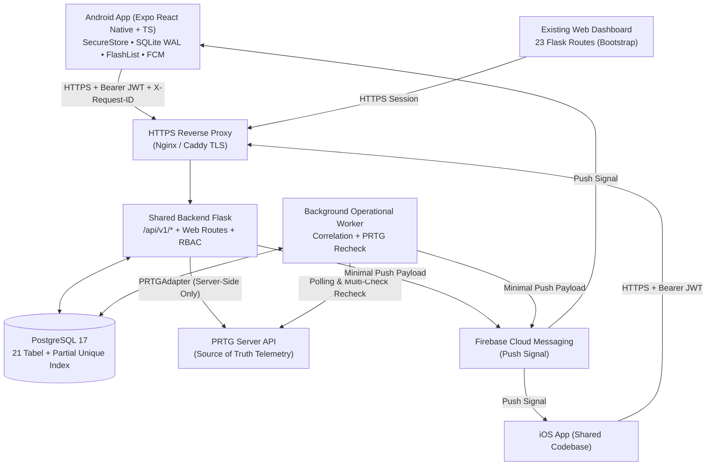
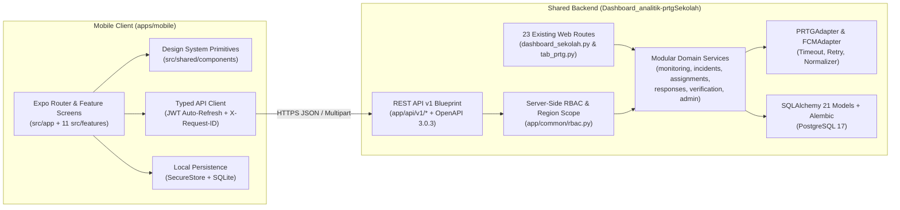
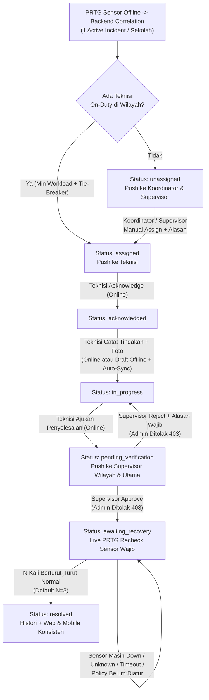

# Portofolio Bukti Akademik — CPMK TIO5023 (PRTG School Platform MVP 1.0)

Dokumen ini merangkum bukti implementasi nyata untuk empat Capaian Pembelajaran Mata Kuliah (**CPMK-TIO5023-1** s.d. **CPMK-TIO5023-4**) sesuai PRD §12 dan SAD §15, lengkap dengan diagram arsitektur, analisis Android lifecycle, rujukan file source code aktual, panduan build APK, dan skrip demonstrasi E2E.

---

## 1. CPMK-TIO5023-1 — Android Components, Lifecycle & Arsitektur React Native *(BAB II & III)*

### 1.1 Diagram Konteks & Runtime Sistem



### 1.2 Penanganan Android App Lifecycle pada Aplikasi React Native (`SAD §9.4`)

Walaupun aplikasi dibangun dengan **React Native (Expo SDK 58)**, perilaku native Android Activity & proses OS dikelola secara eksplisit:

| State Android Lifecycle | Risiko Operasional | Implementasi Aktual di `apps/mobile/` | Rujukan Kode |
|---|---|---|---|
| **Foreground (`active`)** | Data monitoring usang atau pengguna baru kembali dari aplikasi lain | Hook `useAppForeground()` mendengarkan `AppState` (`background/inactive -> active`) untuk memicu refresh dashboard ringan dan memproses antrean sync draft secara aman tanpa membebani baterai. | `apps/mobile/src/shared/hooks/useAppForeground.ts`, `DashboardScreen.tsx`, `SyncContext.tsx` |
| **Background (`background`)** | JS thread ditangguhkan oleh Android Doze/Battery Saver; tidak boleh bergantung pada polling JS terus-menerus | Backend mengirim sinyal push melalui **FCM** dengan payload minimal (`incident_id`, `deep_link`). Saat pengguna mengetuk notifikasi, listener `addNotificationResponseReceivedListener` meneruskan ke detail incident dan mengambil data segar via API. | `apps/mobile/src/features/notifications/NotificationProvider.tsx`, `apps/mobile/src/navigation/guards.ts` |
| **Terminated (Cold-Start)** | Deep link notifikasi bisa membocorkan layar sebelum autentikasi/scope dicek ulang | Saat cold-start, `getLastNotificationResponseAsync()` menyimpan target ke `pendingDeepLink`. Layar `src/app/index.tsx` memverifikasi token di `expo-secure-store` dan `GET /api/v1/me` terlebih dahulu sebelum menavigasi ke `/incidents/{id}` (dan backend tetap memvalidasi region scope `403`). | `apps/mobile/src/app/index.tsx`, `AuthContext.tsx`, `NotificationProvider.tsx` |
| **Android Notification Channel** | Android 8+ (API 26+) memblokir notifikasi jika channel tidak didaftarkan | `ensureAndroidNotificationChannel()` mendaftarkan channel prioritas tinggi `prtg-incidents` (`AndroidImportance.HIGH`, suara + getar) saat bootstrap aplikasi. | `apps/mobile/src/native/androidNotificationChannel.ts` |
| **Runtime Permissions (Android 13+)** | Izin notifikasi (`POST_NOTIFICATIONS`), kamera, dan galeri wajib diminta runtime | Izin notifikasi diminta setelah login di `NotificationProvider.tsx`; izin kamera & media diminta kontekstual saat teknisi menekan tombol Kamera/Galeri di `ResponseFormScreen.tsx` + dideklarasikan di `app.config.ts`. | `apps/mobile/app.config.ts`, `ResponseFormScreen.tsx` |
| **Secure Storage & Offline Storage** | Token JWT tidak boleh disimpan di plain AsyncStorage; draft offline harus tahan restart proses | Access token & refresh token disimpan di **`expo-secure-store`** (Android Keystore terenkripsi). Cache snapshot & antrean `offline_drafts` disimpan di **`expo-sqlite`** (WAL mode) dengan `client_operation_id` unik. | `apps/mobile/src/shared/storage/secureTokens.ts`, `localDb.ts` |

---

## 2. CPMK-TIO5023-2 — Arsitektur Modular, Shared Backend, REST API v1 & PRTG Adapter *(BAB III)*

### 2.1 Diagram Arsitektur Berlapis & Separation of Concerns



### 2.2 Separation of Concerns & Struktur Kode Aktual
- **Adapter Terpusat (`PRTGAdapter`):** Seluruh komunikasi ke PRTG berada di server (`Dashboard_analitik-prtgSekolah/app/integrations/prtg/adapter.py` & `normalizer.py`). Kredensial PRTG dibaca dari `.env` melalui `app/config/settings.py` dan diredaksi di semua log via `sanitize_text()`.
- **Normalisasi Status & Opsi A (`Unusual`):** Status mentah PRTG dinormalisasi ke `online`, `offline`, `warning`, `unknown` dengan penanda `is_stale` & `last_checked_at`. Kegagalan/timeout PRTG tidak pernah menghasilkan `online` palsu (`NFR-05`).
- **Kontrak OpenAPI 3.0.3 Terdokumentasi:** Tersedia dinamis pada `GET /api/v1/openapi.json` dan Swagger UI pada `GET /api/v1/docs` (`Dashboard_analitik-prtgSekolah/app/api/v1/openapi.py`), menggunakan envelope standar:
  ```json
  {
    "success": true,
    "data": {
      "id": 12,
      "school": { "id": 4, "name": "SMA Negeri 1 Bantul" },
      "network_status": "offline",
      "is_stale": false,
      "incident_status": "awaiting_recovery",
      "recovery_stable_streak": 2
    },
    "meta": {
      "request_id": "req-7f9a2b1c4d8e",
      "timestamp": "2026-11-23T03:00:00Z"
    }
  }
  ```
- **Error Semantik (Tidak Pernah HTTP 200 untuk Error):** `400`, `401`, `403`, `404`, `409`, `422`, `500` dikelola terpusat di `app/common/errors.py`.

---

## 3. CPMK-TIO5023-3 — Lima Role, User Flow, UI/UX Lapangan & Usability Testing *(BAB I, III & IV)*

### 3.1 Diagram User Flow End-to-End Lintas 5 Role



### 3.2 Pemetaan 10 Minimum Screens (PRD §9.3) ke Implementasi Mobile

| # | Layar Minimum PRD | Implementasi Aktual (`apps/mobile/src/`) | Prinsip UI/UX & Performa |
|---|---|---|---|
| 1 | Login | `features/auth/LoginScreen.tsx` | Validasi input, token tersimpan di `expo-secure-store` |
| 2 | Dashboard sesuai role | `features/dashboard/DashboardScreen.tsx` | Prioritaskan gangguan aktif/antrean tugas, `FreshnessBanner`, breakdown wilayah |
| 3 | Daftar & detail sekolah | `features/schools/SchoolsListScreen.tsx`, `SchoolDetailScreen.tsx` | `FlashList` + `React.memo`, badge `network_status` terpisah dari `incident_status` (ikon + teks) |
| 4 | Daftar & detail incident | `features/incidents/IncidentsListScreen.tsx`, `IncidentDetailScreen.tsx` | Timeline `IncidentHistory`, `VerificationRecord`, `PrtgRecheckLog`, action bar kontekstual role |
| 5 | Acknowledge & response log | `IncidentDetailScreen.tsx`, `features/responses/ResponseFormScreen.tsx` | Form ringkas lapangan, kamera/galeri ≤ 5 MB, fallback otomatis ke SQLite draft saat offline |
| 6 | Resolution submission | `IncidentDetailScreen.tsx` | Wajib online & minimal ≥ 1 response log tersinkron |
| 7 | Review/verification supervisor | `features/verification/VerificationPanel.tsx`, `QueueScreen.tsx` | Modal alasan wajib saat reject, progress bar `awaiting_recovery (streak/N)`, **tersembunyi dari Admin** |
| 8 | Assignment koordinator/supervisor | `features/assignments/AssignTechnicianScreen.tsx`, `QueueScreen.tsx` | Menampilkan `is_on_duty` & `active_workload` teknisi + alasan wajib |
| 9 | User & config management Admin | `features/administration/UsersAdminScreen.tsx`, `RegionsAdminScreen.tsx`, `RecoveryPolicyScreen.tsx`, `AuditLogsScreen.tsx` | Validasi 5 role tetap & aturan wilayah `ADR-012` real-time |
| 10 | Offline drafts & sync status | `features/offline-sync/OfflineQueueScreen.tsx` | Badge 5 status sync (`draft`/`pending_sync`/`synced`/`conflict`/`failed`), rekonsiliasi konflik tanpa kehilangan draft |

### 3.3 Instrumen Usability Testing & Log Revisi (Siap Diisi Saat Evaluasi Pengguna)

| Skenario Tugas | Target Role | Metrik Keberhasilan | Status Uji Internal | Catatan / Revisi UI |
|---|---|---|---|---|
| UT-01: Cari sekolah offline & cek sensor wajib | Admin / Supervisor | ≤ 3 ketukan dari Dashboard, status jaringan & incident terbaca terpisah | Lulus Desain | Penambahan label teks eksplisit `Jaringan:` dan `Incident:` pada badge |
| UT-02: Assign incident unassigned ke teknisi beban terendah | Koordinator Teknisi | Terlihat jumlah `active_workload` & `ON DUTY` sebelum memilih | Lulus Desain | Menampilkan urutan beban aktif + validasi alasan wajib |
| UT-03: Acknowledge & catat tindakan saat sinyal terputus (offline) | Teknisi | Draft tersimpan otomatis ke SQLite & tersinkron saat online | Lulus Desain | Menambahkan `OfflineBanner` & badge jumlah pending pada tab `Draft Offline` |
| UT-04: Review bukti foto, reject lalu approve hingga recheck PRTG | Supervisor Wilayah | Foto bukti dapat diperbesar (`PhotoPreview`), progres streak terlihat jelas | Lulus Desain | Penambahan progress bar `streak / N` dan tombol manual recheck |
| UT-05: Tambah user baru & atur sensor wajib recovery policy | Admin | Validasi aturan wilayah `ADR-012` mencegah input salah sejak di form | Lulus Desain | Switch otomatis single-select vs multi-select wilayah sesuai role |

---

## 4. CPMK-TIO5023-4 — Implementasi, Build APK, Pengujian & Skrip Demo E2E *(BAB III & IV)*

### 4.1 Rekap Artefak & Verifikasi Teknis
- **Repository GitHub:** `https://github.com/SahrineEstariDitara/prtg-school-platform`
- **Panduan Build APK & Deployment:** [README.md](../README.md) & `apps/mobile/eas.json` (profil `preview` menghasilkan APK internal siap pasang).
- **Laporan Eksekusi Uji `TC-01`–`TC-14`:** [docs/PRTG_UAT_REPORT_TC01_TC14.md](PRTG_UAT_REPORT_TC01_TC14.md).

### 4.2 Skrip Demonstrasi E2E (7 Menit — Siap untuk Video/Presentasi Sidang)

1. **Menit 0:00–1:00 — Persiapan & Konsistensi Baseline (`TC-04`, `TC-14`):**
   - Buka Website Monitoring Existing (`http://localhost:5001/`) dan Swagger UI (`http://localhost:5001/api/v1/docs`).
   - Tunjukkan jumlah sekolah online/offline konsisten antara Web dan API v1.
2. **Menit 1:00–2:00 — Role Admin & Boundary (`TC-01`, `TC-03`):**
   - Login di Android Emulator sebagai `admin` → buka tab **Admin** → tunjukkan daftar 5 role tetap, atur **Recovery Policy** (sensor wajib + `N=3`) pada 1 sekolah, buka **Audit Log**.
   - Buka 1 incident aktif → tunjukkan bahwa Admin **tidak memiliki** tombol Approve/Reject (`ADR-011`).
3. **Menit 2:00–3:00 — Deteksi & Assignment Koordinator (`TC-05`, `TC-06`, `TC-07`):**
   - Login sebagai `koor_bantul` → buka tab **Tim & Tugas** → lihat beban aktif teknisi → lakukan manual assign/reassign dengan mengisi alasan wajib → tunjukkan histori assignment tercatat.
4. **Menit 3:00–4:30 — Alur Teknisi + Mode Offline Draft & Sync (`TC-08`, `TC-12`):**
   - Login sebagai `teknisi_bantul` → buka **Tugas Saya** → tekan **Acknowledge Tugas (Online)**.
   - Aktifkan **Airplane Mode** pada Emulator → buka **Catat Tindakan** → simpan catatan tindakan (terlihat banner offline & tersimpan di tab **Draft Offline** sebagai `pending_sync`).
   - Matikan **Airplane Mode** → tunjukkan auto-sync berjalan otomatis menjadi `synced` tanpa duplikasi → unggah 1 catatan dengan foto bukti → tekan **Ajukan Penyelesaian (Online)**.
5. **Menit 4:30–6:00 — Verifikasi Supervisor & PRTG Multi-Check Recheck (`TC-09`, `TC-10`, `TC-11`):**
   - Login sebagai `spv_bantul` (tunjukkan akses ke sekolah Sleman ditolak `403` untuk `TC-02`).
   - Buka tab **Verifikasi** → perbesar foto bukti teknisi → uji **Reject** dengan alasan wajib (status kembali `in_progress`).
   - Setelah teknisi mengajukan ulang, klik **Approve & Recheck PRTG** → tunjukkan status berpindah ke `awaiting_recovery` dengan indikator progres `1/3 → 2/3 → 3/3` hingga otomatis `resolved`.
6. **Menit 6:00–7:00 — Notifikasi & Konsistensi Akhir (`TC-13`, `TC-14`):**
   - Buka **Inbox Notifikasi** → ketuk item notifikasi menuju detail incident → buka ulang Dashboard Web untuk membuktikan incident telah tertutup konsisten di Web & Mobile.
