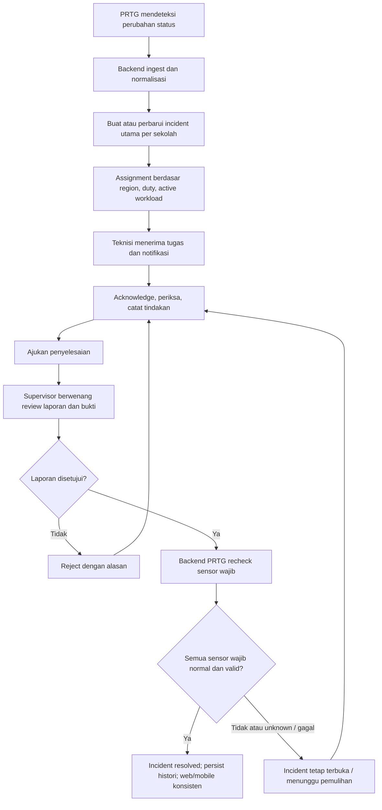
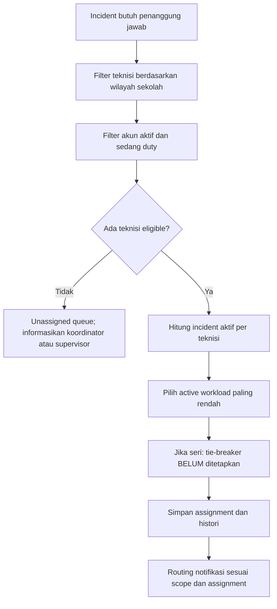
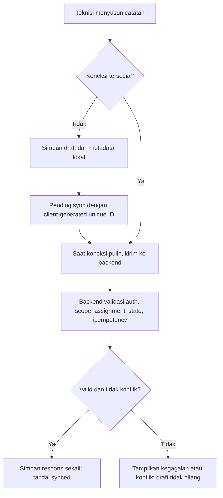
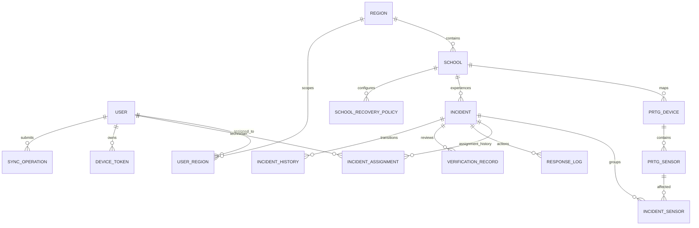

# PRTG School Platform — Konteks PRD untuk AI Agent

> **Sumber utama:** *PRTG School Platform — Product Requirements Document: PRTG School Mobile — Focused MVP 1.0*, PRD-PRTG-001, v0.2, 10 November 2026, 21 halaman. Ini adalah **adaptasi terstruktur untuk AI Agent**, bukan transkripsi kata demi kata. ID `FR`, `NFR`, `AC`, `TC`, ruang lingkup, aturan bisnis, role, dan keputusan terbuka dipertahankan. Diagram Mermaid, pengelompokan pekerjaan, checklist, dan peta ketertelusuran merupakan **interpretasi/panduan agent**, bukan spesifikasi final tambahan.
>
> **Status dokumen:** DRAFT. Framework, route, controller, schema database, sistem autentikasi, deployment, serta cara integrasi PRTG *existing* belum diaudit. Jangan menganggap desain target di sini sudah terimplementasi.
>
> **Dokumen pendamping:** `docs/PRTG_SYSTEM_ARCHITECTURE_AI_CONTEXT.md` (SAD-PRTG-001 v0.2), jika tersedia. **PRD menentukan APA/MENGAPA yang dibutuhkan, SAD menentukan rancangan BAGAIMANA.** Bila keduanya berbeda, laporkan perbedaannya dan ajukan keputusan; jangan melakukan rekonsiliasi diam-diam.

## 0. Petunjuk Baca dan Kontrak Kerja AI Agent

### 0.1 Hirarki informasi

1. **Kebutuhan produk yang disepakati dalam PRD:** tujuan, batas MVP, role, `FR-001`–`FR-027`, `NFR-01`–`NFR-12`, `AC-01`–`AC-14`, dan aturan verifikasi.
2. **Rancangan arsitektur target dalam SAD v0.2:** komponen, API konseptual, domain, model data, dan deployment. Tidak otomatis lebih tinggi dari aturan produk PRD.
3. **Fakta implementasi hasil audit repository:** kode, routes, model, migration, test, konfigurasi, dependency, dan deployment aktual. Jika berbeda dari target, jelaskan kesenjangan *as-is vs to-be* dan migrasikan bertahap.
4. **Keputusan terbuka:** belum menjadi requirement teknis final; butuh audit, baseline, atau persetujuan pemilik produk/operasional.
5. **Usulan agent:** rekomendasi implementasi yang ditandai jelas, bukan fakta atau perubahan requirement otomatis.

### 0.2 Label kepastian

| Label | Arti | Contoh |
|---|---|---|
| `REQUIREMENT` | Perilaku target yang ditentukan PRD | FR-019: incident hanya ditutup setelah sensor wajib memenuhi policy |
| `ACCEPTANCE` | Kondisi yang harus dibuktikan saat pengujian | AC-03: Admin tidak bisa melakukan approval |
| `TARGET` | Kontrak/rancangan yang diinginkan, belum tentu sudah tersedia | API JSON berversi, modul backend bersama |
| `OPEN` | Belum ditentukan; butuh keputusan | Framework backend, tie-breaker, polling interval |
| `ASSUMPTION` | Prasyarat yang perlu diverifikasi | Akses source code dan PRTG API tersedia |
| `OUT_OF_SCOPE` | Sengaja tidak dibuat untuk MVP 1.0 | Diagnostik AI, GPS, chat internal |
| `AGENT_GUIDANCE` | Panduan/interpretasi untuk agent, bukan teks kewajiban langsung dari PRD | Traceability matrix dan checklist pekerjaan |

### 0.3 Guardrails yang wajib dipatuhi

- **PRTG adalah source of truth status jaringan/sensor.** Teknisi/supervisor tidak menulis status `online` buatan ke PRTG.
- **Pisahkan `network_status` dari `incident_status`.** Status monitoring hanya ditentukan telemetry terverifikasi; status penanganan berubah melalui workflow terotorisasi.
- **Website monitoring existing tetap hidup.** Backend existing direfactor bertahap menjadi **shared backend** untuk website dan mobile, tidak di-*rewrite* secara besar tanpa audit.
- **Mobile tidak mengakses PRTG langsung atau membawa credential PRTG.** Akses PRTG server-side melalui backend/adapter.
- **Authorization harus server-side:** role, permission, region scope, account status, dan assignment dicek untuk operasi sensitif. Menyembunyikan UI saja tidak cukup.
- **Lima role tetap**: Admin, Supervisor Utama, Supervisor Wilayah, Koordinator Teknisi, Teknisi. **Admin tidak boleh memverifikasi incident.**
- **Satu rangkaian gangguan pada satu sekolah mempunyai satu incident utama aktif**, yang dapat menghubungkan banyak sensor; wajib deduplication.
- **Penutupan wajib melewati urutan:** submit teknisi → review supervisor yang berwenang → approval → PRTG recheck sensor wajib → `resolved` hanya bila hasil valid dan seluruh sensor wajib normal menurut policy sekolah.
- **PRTG unavailable/timeout, status `unknown`, data `stale`, dan sensor wajib yang belum normal tidak berarti pulih.** Jangan tutup incident.
- **Offline MVP terbatas untuk cache dan draft respons.** Assignment, approval, penyelesaian final, dan tindakan yang mengubah state resmi memerlukan backend online.
- **Audit/history dipertahankan.** Jangan hilangkan histori assignment lama, catatan respons, verifikasi, atau perubahan role dan konfigurasi.
- **Jangan menambah fitur di luar MVP atau mengarang angka SLA/performance, interval polling, minimum OS, atau library final.**

### 0.4 Format output ketika AI Agent mengerjakan task

Sebelum mengubah kode, jelaskan ringkas: (a) requirement `FR/NFR/AC/TC` yang terkait; (b) temuan kode existing; (c) gap dengan target; (d) usulan perubahan minimal beserta tes. Setelah perubahan, sertakan file yang diubah, migration/rollback, tes yang berjalan atau tidak, risiko yang tersisa, dan keputusan terbuka. Jangan menyatakan fitur selesai hanya karena kode sudah ditulis.

---

## 1. Ringkasan Produk dan Konteks (PRD §1, hlm. 3–4)

**Produk:** PRTG School Platform dengan **PRTG School Mobile — Focused MVP 1.0**, aplikasi React Native cross-platform Android/iOS yang terhubung ke **website monitoring existing** melalui **backend existing yang direfactor menjadi layanan bersama**.

**Masalah produk:** Data monitoring PRTG perlu dihubungkan ke tindak lanjut teknisi; notifikasi perlu sesuai wilayah, duty dan assignment; respons dan bukti harus dapat ditelusuri; laporan teknisi tidak membuktikan jaringan telah pulih; closure perlu review supervisor plus PRTG recheck; web dan mobile harus konsisten.

**Bukan tujuan produk:** menggantikan PRTG atau seluruh fungsi website monitoring.

### 1.1 Tujuan produk (PRD §2.1, hlm. 4)

1. Aplikasi mobile untuk kelima role sesuai kewenangan.
2. Status sekolah, perangkat, sensor dari PRTG melalui backend existing.
3. Notifikasi gangguan sesuai wilayah, jadwal/duty, assignment.
4. Workflow lengkap: deteksi → assignment → respons → resolution submission → verifikasi → closure.
5. Status jaringan tidak berubah akibat aksi manual teknisi.
6. Cache dan draft offline saat koneksi tak tersedia.
7. REST/JSON terstandar dari shared backend untuk konsistensi web/mobile.

### 1.2 Indikator keberhasilan (PRD §2.3, hlm. 4–5)

| Indikator | Verifikasi | Kriteria MVP |
|---|---|---|
| Konsistensi monitoring | Bandingkan hasil PRTG, backend, web, mobile | Tidak ada Online/Offline palsu yang menggantikan PRTG |
| Keterlacakan incident | Audit deteksi hingga closure | Setiap incident memiliki histori yang dapat ditelusuri |
| Kepatuhan verifikasi | Audit incident `resolved` | **100%** memiliki approval supervisor + recheck PRTG sesuai policy |
| Pembatasan akses | Positive/negative auth tests | Tidak ada akses tidak sah pada skenario uji |
| Keandalan offline draft | Offline, kembali online, retry | Draft tidak hilang/terduplikasi pada skenario uji |
| Routing notifikasi | Uji Android/iOS | Penerima sesuai region dan assignment |

> Target numerik waktu API, notifikasi, availability, throughput, dan kapasitas **belum ditentukan**; perlu baseline nyata.

---

## 2. Pengguna, Role dan Authorization (PRD §3, hlm. 5–6)

### 2.1 Definisi role

| Role | Cakupan | Tanggung jawab utama | Pembatasan penting |
|---|---|---|---|
| **Admin** | Global administrasi/monitoring | CRUD/aktif-nonaktif akun, assign salah satu dari lima role, konfigurasi wilayah/sistem yang diizinkan, monitoring global, audit admin | **Tidak boleh approve/reject incident** |
| **Supervisor Utama** | Semua wilayah operasional | Monitoring seluruh wilayah, assignment override, verifikasi lintas wilayah | Bukan pengelola akun/role secara default |
| **Supervisor Wilayah** | Region yang ditetapkan | Monitoring region, penugasan sesuai scope, review dan verifikasi incident region | Tidak verifikasi di luar scope |
| **Koordinator Teknisi** | Tim/region yang ditetapkan | Assignment/reassignment, pantau workload/progres tim | Tidak verifikasi penyelesaian |
| **Teknisi** | Wilayah tugas dan incident assigned | Terima tugas, acknowledge, catat tindakan, draft offline, submit resolusi | Tidak mengelola akun/role, assign orang lain, atau approve |

### 2.2 Matriks akses baseline (PRD §3.2)

Keterangan: `YA` = diizinkan sesuai scope; `TIDAK` = dilarang dalam baseline; `TERBATAS` = bergantung kewenangan; `OPSIONAL` = tidak otomatis diberikan, kebijakan lebih detail belum ditetapkan.

| Operasi | Admin | Supervisor Utama | Supervisor Wilayah | Koordinator | Teknisi |
|---|---|---|---|---|---|
| Monitoring global | YA | YA | TIDAK | TIDAK | TIDAK |
| Monitoring sesuai wilayah | YA | YA | YA | YA | YA |
| Kelola akun dan assign role | YA | TIDAK | TIDAK | TIDAK | TIDAK |
| Konfigurasi sistem/wilayah | YA | TERBATAS operasional | TIDAK | TIDAK | TIDAK |
| Lihat incident | Monitoring view | Global | Wilayah | Tim/wilayah | Assigned/scope |
| Assign/reassign | TIDAK | YA | YA | YA | TIDAK |
| Catat respons | TIDAK | OPSIONAL operasional | OPSIONAL | OPSIONAL | YA |
| Ajukan penyelesaian | TIDAK | OPSIONAL jika assigned | OPSIONAL jika assigned | TIDAK | YA |
| Approve/reject penyelesaian | TIDAK | Global | Wilayah | TIDAK | TIDAK |
| Lihat audit administratif | YA | TERBATAS | TERBATAS | TERBATAS | TIDAK |

**Catatan baseline:** Matriks ini belum menjadi spesifikasi permission granular final. Jangan memberi hak tambahan kepada supervisor/koordinator hanya berdasarkan label `OPSIONAL`. Jika implementasi memerlukan aksi di luar teknisi, harus ada spesifikasi policy dan pengujian terpisah. Detail multi-region belum final.

### 2.3 Manajemen pengguna (PRD §3.3)

- Hanya Admin yang membuat, mengubah, mengaktifkan/nonaktifkan akun, menetapkan role, dan menetapkan region kerja pada MVP.
- Tidak ada self-registration yang langsung memberi akses operasional tanpa persetujuan Admin.
- Role, status akun dan perubahan region dicatat dalam audit log.
- Tidak ada custom permission builder.

### 2.4 Aturan pemeriksaan akses (AGENT_GUIDANCE)

Untuk tiap endpoint/aksi sensitif: autentikasi → status akun aktif → permission role → region scope → keterkaitan dengan incident/assignment → validasi lifecycle → audit. Harus ada negative test untuk Admin approve, akses lintas wilayah, dan teknisi yang bukan assignee. Detail middleware dan claim token ditentukan dari audit backend existing, **bukan diasumsikan**.

---

## 3. Ruang Lingkup Focused MVP 1.0 (PRD §4, hlm. 6–7)

### 3.1 Enam modul MVP

| No. | Modul | Hasil yang wajib dicapai |
|---|---|---|
| 01 | **Authentication & User Access** | Login/logout, token/session, lima role, navigasi per role, permission+scope, admin akun dasar |
| 02 | **Network Monitoring** | Dashboard online/offline, pencarian/filter sekolah, detail sekolah/sensor, waktu pengecekan, stale/unknown |
| 03 | **Incident Management** | Incident utama aktif per sekolah, sensor terkait, status penanganan, history, deduplication dasar |
| 04 | **Assignment & Response** | Auto-assignment sederhana; manual assign/reassign; acknowledge; catatan/foto sederhana jika diperlukan; resolution submission |
| 05 | **Verification & Synchronization** | Supervisor review, approve/reject + alasan, recheck PRTG, required sensors, closure, konsistensi web/mobile |
| 06 | **Notification & Offline Support** | Push Android/iOS, audience routing region/assignment, log, cache, offline draft, sync queue, validasi server |

### 3.2 Di luar MVP (`OUT_OF_SCOPE`)

- Prediksi/diagnosis gangguan berbasis AI.
- Peta interaktif dan GPS tracking teknisi.
- Analitik performa teknisi tingkat lanjut.
- SLA dan eskalasi kompleks.
- Chat internal.
- Offline penuh untuk assignment/approval/perubahan status server.
- Custom permission builder.
- Laporan/ekspor mobile kompleks; ekspor existing pada website dipertahankan.

### 3.3 Batasan pelaksanaan

- Pertahankan PRTG dan website monitoring existing.
- Mobile berkomunikasi ke backend, **bukan langsung ke PRTG**.
- Refactoring backend bertahap; hindari total rewrite tanpa audit.
- Distribusi awal melalui Android/iOS internal testing.

---

## 4. Kebutuhan Fungsional — Sumber Referensi Implementasi (PRD §5, hlm. 7–9)

ID berikut **harus dipertahankan persis** pada ticket, commit/PR, dokumentasi, dan tes jika relevan. Baris berikut adalah parafrase setia terhadap tabel PRD.

### 4.1 Authentication dan monitoring (`FR-001`–`FR-008`)

| ID | Modul | Kebutuhan target | Aktor |
|---|---|---|---|
| **FR-001** | Authentication | Login/logout melalui mekanisme auth backend | Semua role |
| **FR-002** | Role & Scope | Backend memberi role, permission, region scope setelah auth | Semua role |
| **FR-003** | Dashboard | Ringkasan online/offline dan gangguan sesuai scope | Semua role |
| **FR-004** | School List | Cari/filter sekolah berdasarkan nama, wilayah, status | Sesuai scope |
| **FR-005** | School Detail | Tampilkan device/sensor, status, last check, sensor wajib sesuai izin | Sesuai permission |
| **FR-006** | PRTG Data | Backend membaca PRTG API dan normalisasi status | Sistem |
| **FR-007** | Incident Grouping | Satu incident utama aktif per sekolah dan sensor terdampak terkait | Sistem |
| **FR-008** | Status Separation | `network_status` dan `incident_status` tersimpan/ditampilkan terpisah | Sistem |

### 4.2 Penugasan, notifikasi, dan respons (`FR-009`–`FR-016`)

| ID | Modul | Kebutuhan target | Aktor |
|---|---|---|---|
| **FR-009** | Automatic Assignment | Pilih teknisi eligible berdasar region, duty/jadwal, active workload | Sistem |
| **FR-010** | Manual Assignment | Koordinator/supervisor dapat assign/reassign dengan alasan | Koordinator/Supervisor |
| **FR-011** | Notification Routing | Notifikasi tepat region/assignment dan deduplicate | Sistem |
| **FR-012** | Acknowledge | Teknisi assigned mengonfirmasi penerimaan tugas | Teknisi |
| **FR-013** | Response Log | Catat tindakan, hasil, waktu, lampiran sederhana jika diaktifkan | Teknisi |
| **FR-014** | Offline Draft | Draft respons tersimpan lokal saat offline | Teknisi |
| **FR-015** | Offline Sync | Sync saat online menggunakan ID unik/idempotency + backend validation | Sistem |
| **FR-016** | Resolution Submit | Teknisi assigned mengajukan penyelesaian setelah catatan tindakan | Teknisi assigned |

### 4.3 Verifikasi dan administrasi (`FR-017`–`FR-027`)

| ID | Modul | Kebutuhan target | Aktor |
|---|---|---|---|
| **FR-017** | Supervisor Review | Supervisor berwenang approve/reject pengajuan dengan alasan | Supervisor |
| **FR-018** | PRTG Recheck | Setelah approval, backend periksa sensor wajib melalui PRTG API | Sistem |
| **FR-019** | Recovery Policy | Closure hanya jika seluruh sensor wajib normal dan recheck valid | Sistem |
| **FR-020** | Incident History | Catat deteksi, assignment, respons, transisi status, verifikasi, recheck | Sistem |
| **FR-021** | User Management | Admin membuat/mengubah/mengaktifkan/menonaktifkan akun | Admin |
| **FR-022** | Role Assignment | Admin menetapkan salah satu dari lima role tetap | Admin |
| **FR-023** | Region Configuration | Admin mengelola region dan relasi sekolah/pengguna | Admin |
| **FR-024** | Global Monitoring for Admin | Admin melihat global monitoring, **tanpa** verifikasi incident | Admin |
| **FR-025** | Device Registration | Daftar/update push token device | Semua role |
| **FR-026** | Audit Log | Catat perubahan akun, role, konfigurasi, assignment, verifikasi | Sistem |
| **FR-027** | Shared Data | Website dan mobile melihat status/data operasional dari shared backend | Web/Mobile |

### 4.4 User stories dari PRD (§5.1, hlm. 9–10)

- Admin: kelola akun dan role; pantau semua sekolah tanpa hak verifikasi.
- Teknisi: menerima notifikasi tugas; menyimpan draft respons saat offline.
- Koordinator: melihat jadwal dan beban aktif tim untuk penugasan lebih seimbang.
- Supervisor Wilayah: memeriksa laporan teknisi dan sensor wajib untuk incident wilayah.
- Supervisor Utama: monitoring dan verifikasi lintas wilayah.
- Pengguna website: melihat monitoring/incident yang konsisten dengan mobile.

---

## 5. Workflow Inti dan Aturan Bisnis (PRD §6, hlm. 10–12)

### 5.1 Alur dari PRTG sampai closure

**Rekonstruksi Mermaid dari diagram PRD hlm. 11 dan uraian hlm. 12 (`AGENT_GUIDANCE`):**



> **Perhatian:** Mermaid menyajikan alur konseptual, **bukan transisi state mesin yang sudah disepakati sepenuhnya**. PRD tidak merinci semua guard/transition dan belum menetapkan mekanisme pengulangan recheck. Jangan membangun transisi baru tanpa keputusan.

### 5.2 Korelasi monitoring dan incident (PRD §6.1)

1. Backend membaca PRTG melalui adapter terpusat; mekanisme/interval/timeout/rate limit perlu audit.
2. Normalisasi sensor: `online`, `offline`, `warning`, `unknown`.
3. Gunakan identitas stabil `school`, `device`, `sensor` untuk korelasi/deduplication.
4. Satu rangkaian gangguan pada sekolah → **satu incident utama aktif**; sensor-sensor terdampak ditautkan.
5. Pembacaan gagal atau stale → `unknown`/indikator `stale`, **bukan** status `online` palsu.

### 5.3 Assignment otomatis sederhana (PRD §6.2)



Aturan:

- Eligibility mengikuti **urutan wilayah → akun aktif & duty → jumlah incident aktif**.
- Rule tie-breaker **OPEN**, bukan otomatis round-robin atau acak.
- Koordinator, Supervisor Wilayah, Supervisor Utama boleh override sesuai scope dengan alasan.
- Audit assignment mencatat perubahan; assignment sebelumnya tidak dihapus.
- Tidak ada kandidat → unassigned queue + notifikasi terkait.
- Race condition dua penugas perlu transaksi/locking/constraint sesuai temuan repository.

### 5.4 Review supervisor dan PRTG recovery policy (PRD §6.3–6.5)

- Teknisi assigned mengisi catatan, mengajukan penyelesaian, dan bukti jika diwajibkan.
- Hanya Supervisor Wilayah atau Supervisor Utama yang berwenang yang boleh review/verify.
- Reject harus disertai alasan dan mengembalikan incident ke proses tindak lanjut.
- Approve berarti **laporan/tindakan diterima**, bukan jaringan otomatis normal.
- Setelah approve, backend wajib membaca **semua sensor wajib** sesuai `SchoolRecoveryPolicy` sekolah melalui PRTG API.
- Hanya apabila seluruh sensor wajib memenuhi kondisi normal **dan recheck valid**, incident boleh `resolved`.
- Sensor `offline`, `warning` yang tidak memenuhi policy, `unknown`, `stale`, atau kegagalan API → tidak ditutup; simpan hasil pemeriksaan dan tampilkan status terbuka/menunggu pemulihan.
- Penetapan sensor wajib dan definisi `normal` adalah konfigurasi per sekolah. Aturan durasi stabil, beberapa pembacaan berturut-turut, atau sensor alternatif **OPEN**.
- Admin **tidak** diberi hak approve/reject, sekalipun Admin mengonfigurasi sekolah/sensor.

### 5.5 Pemisahan state (PRD §6.4)

| Domain | Nilai eksplisit pada PRD | Sumber perubahan |
|---|---|---|
| `network_status` | `online`, `offline`, `warning`, `unknown` | Telemetry PRTG melalui backend |
| `incident_status` / response | `detected`, `assigned`, `acknowledged`, `in_progress`, `resolution_submitted`, `pending_verification`, `awaiting_recovery`, `resolved`, `reopened` / kebijakan incident baru | Workflow terotorisasi |
| `stale` | Indikator umur/keterbaruan pembacaan; **bukan** nilai network status tambahan yang dipastikan PRD | Data freshness dari proses ingest |

**Penting:** Kolom kiri/kanan pada tabel status PDF **bukan pasangan satu-ke-satu**. `network_status=online` tidak otomatis membenarkan `incident_status=resolved` tanpa approval dan recheck. PRD belum mengunci semua state transition; `reopened` disebut bersama opsi *kebijakan incident baru*, yang memerlukan keputusan final.

### 5.6 Offline draft dan sinkronisasi aman (PRD §4, §5, §7, §8)



**Boleh saat offline:** melihat cache yang sudah ada, menyiapkan catatan/draft dan lampiran lokal. **Harus online:** aksi server seperti assignment/reassignment, approval/reject, submit final, closure dan perubahan state resmi. `client_operation_id`/UUID, idempotency, validasi server, dan conflict handling diperlukan; retensi draft, TTL cache, batas ukuran foto, serta strategi rekonsiliasi **OPEN**.

### 5.7 Push notification dan routing

- Notifikasi ke perangkat Android dan iOS, dikaitkan dengan wilayah, duty, dan assignment pengguna.
- Deduplication untuk satu event dan logging hasil pengiriman.
- Registrasi/pembaruan token perangkat (`FR-025`).
- Push bersifat sinyal dan tidak menggantikan API/data operasional backend; jangan menyimpulkan pesan sudah dibaca hanya dari sukses provider (ketentuan rinci ini dijelaskan pada SAD).
- Retry, cooldown, prioritas, jam kirim, eskalasi sederhana, dan pilihan library/provider belum final.

---

## 6. Kebutuhan Nonfungsional (`NFR-01`–`NFR-12`; PRD §7, hlm. 13)

| ID | Kategori | Kriteria target |
|---|---|---|
| **NFR-01** | Security | HTTPS mobile/backend; credential PRTG **hanya di server** |
| **NFR-02** | Authorization | Cek role, permission, region, assignment pada setiap operasi sensitif |
| **NFR-03** | Data integrity | Assignment, approval, closure, sync aman dari duplikasi/race condition |
| **NFR-04** | Auditability | Jejak perubahan status, assignment, verifikasi, akun, role, konfigurasi |
| **NFR-05** | Availability | Kegagalan PRTG API tidak menciptakan status pulih palsu; stale/unknown |
| **NFR-06** | Cross-platform | Fungsi inti konsisten di Android dan iOS |
| **NFR-07** | Offline resilience | Cache/draft lokal aman dan sync idempotent |
| **NFR-08** | Maintainability | Web dan mobile berbagi business logic backend; API berversi/terdokumentasi |
| **NFR-09** | Observability | Structured log, request ID, pencatatan error PRTG integration |
| **NFR-10** | Privacy | Payload push seminimal mungkin; retensi foto mengikuti kebijakan |
| **NFR-11** | Performance | Target respons/kapasitas ditetapkan setelah baseline server/sekolah/sensor/pengguna |
| **NFR-12** | Compatibility | Minimum versi Android/iOS ditentukan sebelum internal testing |

**Agent test implication (`AGENT_GUIDANCE`):** buat pengujian eksplisit untuk negative authorization, duplicate submission, concurrent assignment, kegagalan/retry integrasi, cold-start/resume mobile, offline→online, dan regresi website. Jangan mengisi target numerik sendiri.

---

## 7. Data dan Integrasi (PRD §8, hlm. 14–15)

### 7.1 Entitas konseptual

> Nama di bawah adalah **konsep domain**, bukan bukti tabel fisik di database.

| Entitas konseptual | Tujuan |
|---|---|
| `User`, `Role`, `Permission` | Akun, role tetap, dan hak akses |
| `Region`, `UserRegion` | Cakupan satu atau lebih region per user; detail kebijakan multi-region terbuka |
| `School` | Sekolah dan pemetaan region/identitas PRTG |
| `PRTGDevice`, `PRTGSensor` | Pemetaan device/sensor ke sekolah |
| `SchoolRecoveryPolicy` | Daftar sensor wajib + kriteria pemulihan per sekolah |
| `Incident`, `IncidentSensor` | Incident utama dan sensor terkait |
| `IncidentAssignment` | Penanggung jawab, perubahan, alasan, sejarah assignment |
| `ResponseLog` | Catatan pemeriksaan, tindakan, waktu, bukti |
| `VerificationRecord` | Supervisor, keputusan, alasan, waktu, hasil review/recheck |
| `IncidentHistory` | Riwayat lifecycle dan perubahan status |
| `DeviceToken`, `NotificationLog` | Registrasi device dan histori push |
| `AuditLog`, `SyncOperation` | Audit administratif dan sinkronisasi draft |

### 7.2 Relasi konseptual (`AGENT_GUIDANCE`, bukan ERD final)



> Relasi banyaknya `SchoolRecoveryPolicy` dan kardinalitas teknis lain **masih konseptual**; diagram tidak menetapkan constraint/migration fisik. Validasi model terhadap schema existing sebelum implementasi.

### 7.3 Integrasi eksternal

| Integrasi | Kontrak produk | Ketidakpastian |
|---|---|---|
| PRTG API | Baca status sensor/device, lakukan recheck pemulihan | Endpoint, auth, rate limit, interval, polling/trigger |
| Website existing | Berjalan terus dan tampilkan monitoring/incident dari backend bersama | Route/view lama dan migrasi setelah audit |
| REST API mobile | JSON terstandar, berversi; web boleh mempertahankan route existing | Endpoint konkret dan payload final ditetapkan contract review |
| Push provider | FCM / layanan push Apple untuk Android/iOS | Pilihan library/runtime, retry/cooldown |
| Mobile local storage | Cache, draft, sync queue | Teknologi, enkripsi, TTL, retensi, conflict UI |

### 7.4 Konvensi REST API (PRD §8.3)

- Prefix versi seperti `/api/v1` adalah **contoh target**, bukan route yang sudah ada.
- JSON success/error memiliki struktur konsisten: `success`, `data`, `meta`, serta `error` saat gagal.
- Gunakan HTTP status yang benar; **jangan semua error dikembalikan sebagai HTTP 200**.
- Waktu ISO 8601; penyimpanan konsisten; UI menggunakan zona waktu operasional/pengguna.
- Filtering, pagination, dan detail endpoint sesuai kebutuhan.
- Dokumentasi OpenAPI/Swagger untuk kontrak frontend–backend.

**Contoh respons ilustratif dari PRD (§8.4):**

```json
{
  "success": true,
  "data": {
    "id": "incident-123",
    "school": { "id": "school-10", "name": "SMA Negeri 1 Bantul" },
    "network_status": "offline",
    "incident_status": "in_progress"
  },
  "meta": { "request_id": "req-abc123" }
}
```

> Isi contoh adalah *sample* dokumen. **Bukan payload aktual backend existing**. Rincian route pada SAD juga konseptual dan baru boleh diimplementasikan setelah pemetaan repository dan review kontrak.

---

## 8. Mobile UI/UX dan Navigasi (PRD §9, hlm. 15–16)

### 8.1 Prinsip UI/UX

- Dahulukan tugas yang memerlukan tindakan (gangguan aktif, tugas teknisi), bukan statistik dekoratif.
- Satu aplikasi, navigasi **role-aware**.
- Selalu bedakan status jaringan dan status incident.
- Gunakan teks/ikon/label, **jangan mengandalkan warna saja**.
- Tampilkan waktu update dan stale indicator.
- Form teknisi ringkas untuk penggunaan lapangan.

### 8.2 Navigasi baseline per role

| Role | Menu utama sesuai PRD |
|---|---|
| Admin | Dashboard Monitoring · Pengguna · Role/Permission · Wilayah/Konfigurasi · Audit Log · Profil |
| Supervisor Utama | Dashboard · Monitoring · Gangguan · Verifikasi · Assignment/Tim · Riwayat |
| Supervisor Wilayah | Dashboard Wilayah · Gangguan · Verifikasi · Assignment/Tim · Riwayat |
| Koordinator Teknisi | Dashboard Tim · Gangguan Wilayah · Penugasan · Beban Kerja · Riwayat Tim |
| Teknisi | Beranda · Tugas/Gangguan Saya · Notifikasi · Draft Offline · Riwayat · Profil |

### 8.3 Minimum screens

1. Login/pemulihan akses sesuai kebijakan.
2. Dashboard sesuai role.
3. Daftar sekolah + detail monitoring.
4. Daftar incident + detail incident.
5. Form acknowledge + response log teknisi.
6. Form resolution submission.
7. Review/verification supervisor.
8. Assignment koordinator/supervisor.
9. User management dasar Admin.
10. Offline drafts + sync status.

**Catatan:** Versi minimum OS, Expo vs native, penyimpanan lokal, library push, dan desain UI final belum ditetapkan. Jangan berasumsi terdapat halaman/tampilan dalam repository sebelum audit.

---

## 9. Acceptance Criteria Resmi (`AC-01`–`AC-14`; PRD §10.1, hlm. 16–17)

| ID | Kriteria penerimaan |
|---|---|
| **AC-01** | Setelah login hanya menu dan data sesuai role/region scope yang terlihat |
| **AC-02** | Admin kelola akun dan lima role, serta melihat monitoring global |
| **AC-03** | Admin **tidak bisa** approve/reject resolution submission |
| **AC-04** | Dashboard status dari PRTG via backend; stale/unknown ditampilkan |
| **AC-05** | Gangguan sensor satu sekolah dikorelasikan ke incident utama, mengikuti dedup policy |
| **AC-06** | Auto-assignment hanya teknisi sesuai wilayah, aktif/duty, dan mempertimbangkan workload |
| **AC-07** | Assign/reassign oleh koordinator/supervisor berwenang dan alasan tersimpan |
| **AC-08** | Teknisi bisa acknowledge, catat tindakan, dan ajukan penyelesaian |
| **AC-09** | Verification hanya supervisor dengan scope yang sesuai |
| **AC-10** | Approval laporan memicu backend PRTG recheck sensor wajib |
| **AC-11** | Incident tidak `resolved` bila sensor wajib belum normal, unknown, atau PRTG gagal |
| **AC-12** | Website dan mobile menampilkan monitoring/incident konsisten lewat shared backend |
| **AC-13** | Draft offline tersinkron tanpa hilang/duplikasi pada skenario uji |
| **AC-14** | Perubahan role, assignment, verifikasi, konfigurasi tertelusur lewat audit/history |

---

## 10. Test Cases Minimum (`TC-01`–`TC-14`; PRD §10.2, hlm. 17)

| ID | Skenario | Ekspektasi |
|---|---|---|
| **TC-01** | Login setiap role | Dashboard/navigasi sesuai role |
| **TC-02** | Akses lintas wilayah | Data/incident wilayah lain ditolak jika di luar scope |
| **TC-03** | Admin role boundary | User management/monitoring boleh; incident approval ditolak |
| **TC-04** | Ingest status PRTG | Sensor sesuai sumber; API gagal → unknown/stale |
| **TC-05** | Correlation incident | Banyak sensor terkait tidak menciptakan incident/notifikasi duplikat |
| **TC-06** | Assignment eligibility | Pilihan sesuai wilayah/duty/beban; fallback bila tidak ada kandidat |
| **TC-07** | Manual reassignment | Koordinator/supervisor sesuai scope; histori disimpan |
| **TC-08** | Response submission | Catatan tindakan dan pengajuan tersimpan |
| **TC-09** | Supervisor rejection | Penolakan dengan alasan; incident kembali ditangani |
| **TC-10** | Recovery validation | `resolved` hanya jika semua sensor wajib memenuhi policy |
| **TC-11** | PRTG API unavailable | Tidak tutup incident saat recheck gagal/unknown |
| **TC-12** | Offline draft sync | Sinkron setelah online, tanpa duplikasi |
| **TC-13** | Push routing | Penerima benar berdasar region/assignment pada Android/iOS |
| **TC-14** | Web/mobile consistency | Data web/mobile konsisten setelah perubahan backend |

### 10.1 Bukti implementasi dan demonstrasi (PRD §10.3)

- Repository source + README konfigurasi/build.
- APK Android internal/demonstrasi.
- iOS build atau TestFlight sesuai ketersediaan akun/perangkat.
- API docs + contoh request/response.
- Bukti pengujian fungsional, auth, offline sync, push, PRTG recheck.
- Video atau demo alur deteksi sampai supervisor verification.

---

## 11. Peta Traceability untuk AI Agent (`AGENT_GUIDANCE`)

> Pemetaan berikut merupakan **usulan penghubung requirement ke test** berdasarkan makna PRD; ini **bukan** matriks resmi pada PDF. Validasi mapping dalam perencanaan sprint sebelum menjadikannya gate formal.

| FR | AC terdekat | TC terdekat | Modul |
|---|---|---|---|
| FR-001 | AC-01 | TC-01 | Auth |
| FR-002 | AC-01 | TC-01, TC-02 | RBAC/scope |
| FR-003 | AC-04 | TC-04, TC-14 | Dashboard |
| FR-004 | AC-01, AC-04 | TC-02, TC-14 | School list |
| FR-005 | AC-04 | TC-04 | School details |
| FR-006 | AC-04 | TC-04 | PRTG ingest |
| FR-007 | AC-05 | TC-05 | Correlation |
| FR-008 | AC-04, AC-11 | TC-04, TC-10 | Status domains |
| FR-009 | AC-06 | TC-06 | Auto assignment |
| FR-010 | AC-07, AC-14 | TC-07 | Manual assignment |
| FR-011 | AC-05 | TC-05, TC-13 | Notification |
| FR-012 | AC-08 | TC-08 | Acknowledge |
| FR-013 | AC-08 | TC-08 | Response log |
| FR-014 | AC-13 | TC-12 | Offline draft |
| FR-015 | AC-13 | TC-12 | Offline sync |
| FR-016 | AC-08 | TC-08 | Resolution submission |
| FR-017 | AC-03, AC-09 | TC-03, TC-09 | Supervisor review |
| FR-018 | AC-10, AC-11 | TC-10, TC-11 | PRTG recheck |
| FR-019 | AC-11 | TC-10, TC-11 | Recovery policy |
| FR-020 | AC-14 | TC-07, TC-09 | Incident history |
| FR-021 | AC-02 | TC-03 | User management |
| FR-022 | AC-02, AC-14 | TC-01, TC-03 | Role assignment |
| FR-023 | AC-01, AC-14 | TC-02, TC-03 | Region configuration |
| FR-024 | AC-02, AC-03 | TC-03 | Global monitoring |
| FR-025 | AC-01 | TC-13 | Push token |
| FR-026 | AC-14 | TC-07, TC-09 | Audit |
| FR-027 | AC-12 | TC-14 | Shared data |

### 11.1 Kriteria selesai per task (`AGENT_GUIDANCE`)

- Cantumkan nomor FR, NFR, AC, TC yang terdampak.
- Periksa scope role dan negatif cases bila menyentuh data/aksi terotorisasi.
- Periksa status sumber PRTG, stale/unknown, deduplication, dan audit bila menyentuh monitoring/incident.
- Periksa transaksi/idempotency untuk assignment, submission, sync.
- Uji kompatibilitas website jika mengubah business logic bersama, model data, query, atau API.
- Bukti test/preview build nyata; jangan mengklaim lulus tanpa menjalankan.
- Catat perubahan skema, cara rollback, dan keputusan terbuka.

---

## 12. Risiko, Asumsi, dan Keputusan Terbuka (PRD §11, hlm. 18–19)

### 12.1 Risiko dan mitigasi awal

| Risiko | Dampak | Mitigasi dari PRD |
|---|---|---|
| Refactor backend merusak website | Monitoring operasional terganggu | Baseline tests, perubahan bertahap, backward compatibility, rollback/feature flag |
| PRTG API lambat/gagal | Status tidak bisa diverifikasi | Timeout, retry terbatas, stale/unknown, jangan auto-resolve |
| Duplikasi sensor event | Incident/push ganda | Correlation key, satu active incident per sekolah, deduplication |
| Assignment race condition | Dua teknisi jadi assignee | Transaksi/locking/constraint DB |
| Permission/region salah | Akses tidak sah | RBAC+scope backend dan negative auth test |
| Offline sync conflict | Draft hilang/duplikat | UUID, idempotency, append-only response, server validation |
| Sensor wajib belum ditentukan | Salah closure/tidak dapat closure | Validasi recovery policy tiap sekolah |
| Push tidak terkirim | Teknisi lambat menerima tugas | Notification log, retry terukur, in-app inbox fallback |

### 12.2 Asumsi yang harus diverifikasi (`ASSUMPTION`)

- Izin penggunaan source code sudah diberikan; bukti izin/atribusi harus disimpan.
- Website existing merupakan sistem operasional yang tetap dipertahankan.
- Backend existing dapat diakses/refactor; bahasa, framework, DB, deployment diaudit lebih dahulu.
- PRTG API bisa membaca sensor dan melakukan recheck.
- Admin adalah satu-satunya pengelola akun dan assign role pada MVP.
- Data jadwal/duty teknisi tersedia atau dapat disiapkan sederhana.

### 12.3 Keputusan terbuka (`OPEN`)

| Topik | Pertanyaan yang belum diputuskan |
|---|---|
| Backend existing | Framework, struktur, route, controller, database, auth, deployment, test coverage |
| PRTG integration | Endpoint, auth, rate limit, interval, polling/recheck strategy |
| Sensor recovery policy | Sensor wajib sekolah, status normal, durasi stabil/pembacaan berturut-turut |
| Assignment | Tie-breaker, bobot jadwal vs beban, max active tasks, fallback |
| Multi-region | Pengguna bisa punya berapa region; prioritas assignment lintas region |
| Notification | Cooldown, priority, retry, quiet hours, eskalasi sederhana |
| Offline data | Storage, cache expiration, draft retention, conflict resolution, batas foto |
| Mobile build | Minimum OS, Expo vs bare/native, push provider, distribusi internal |
| Data governance | Retensi response log, bukti foto, audit, privasi organisasi |
| Performance | Latency, throughput, availability, skala sensor/pengguna sesuai baseline |

**Aturan agent:** jika task tergantung keputusan terbuka, sampaikan opsi dan konsekuensinya; jangan menetapkan final tanpa validasi/otorisasi. Implementasikan safe default hanya jika tidak mengubah kebijakan bisnis dan dapat ditarik kembali.

---

## 13. Target Bukti Akademik CPMK TIO5023 (PRD §12, hlm. 19–20)

| CPMK | Fokus proyek | Bukti yang perlu disiapkan | BAB |
|---|---|---|---|
| CPMK-TIO5023-1 | Android components, lifecycle, alur aplikasi, arsitektur React Native | Diagram, uraian foreground/background, push, secure storage, rujukan kode | II, III |
| CPMK-TIO5023-2 | Modul mobile/backend, REST API, data flow, shared service, PRTG | Diagram modul, struktur repository, pemisahan concern, kontrak API, kode | III |
| CPMK-TIO5023-3 | Lima role, user requirements, user flow, wireframe, UI/UX | Wawancara/observasi, requirements, user flow, wireframe, usability test, revisi | I, III, IV |
| CPMK-TIO5023-4 | Implementasi/build, pengujian, demo Android/iOS | APK/build guide/source, test cases dan hasil, uji Android/iOS, demonstrasi | III, IV |

**Catatan:** React Native tidak menghilangkan kewajiban membahas lifecycle Android. PRD **bukan bukti** CPMK telah tercapai; perlu pengujian/pengguna nyata dan build yang dapat dijalankan.

---

## 14. Konflik Istilah dan Hubungan dengan SAD v0.2 (`AGENT_GUIDANCE`)

Berikut catatan rekonsiliasi antar-dokumen. **Jangan mengganti istilah sumber secara sepihak.** Ini bukan klaim bahwa dua dokumen selalu kontradiktif; beberapa perbedaan adalah penambahan rinci pada SAD.

| Pokok | PRD-PRTG-001 v0.2 | SAD-PRTG-001 v0.2 | Aksi aman untuk agent |
|---|---|---|---|
| Status menunggu pemulihan | `awaiting_recovery` (PRD §6.4, hlm. 12) | `pending_recovery` (SAD §5.3/§8.4, hlm. 9/12–13) | **Decision needed:** tentukan satu canonical backend enum + mapping migrasi/API, sebelum membuat schema/API |
| `reopened` vs incident baru | `reopened / kebijakan incident baru` masih opsional | Incident `resolved` tidak digabung dengan gangguan baru | Jangan implement auto-reopen sampai kebijakan final dikunci; jaga histori dan pisahkan gangguan baru dari incident resolved sesuai SAD jika menjadi keputusan yang disetujui |
| Status tambahan workflow | PRD §6.4 berisi `detected`, `assigned`, dll. | SAD menambah `unassigned`, `rejected` dan state lain | Jangan mengasumsikan daftar enum final; buat state machine final dan review |
| Status sync | PRD membahas draft, idempotency, validasi | SAD mencantumkan `draft`, `pending_sync`, `synced`, `conflict`, `failed` | SAD dapat jadi referensi implementasi, tetapi tetap perlu kontrak final |
| Penanganan respons oleh supervisor | PRD baseline memberi respons/submit terbatas secara opsional | SAD umumnya memusatkan `responses.create` pada teknisi assigned | Tahan izin opsional sampai policy RBAC final disetujui |
| Backend/endpoint | Tidak diverifikasi | Menawarkan tree direktori dan contoh `/api/v1/...` | Perlakukan sebagai target, bukan kondisi repository |

**Prioritas verifikasi bersama product owner/tech lead:** 1) canonical incident state enum; 2) rules state transition; 3) actor permission pada aksi opsional; 4) sensor wajib; 5) tie-breaker assignment; 6) conflict handling offline.

---

## 15. Checklist Saat Agent Melakukan Audit dan Implementasi (`AGENT_GUIDANCE`)

### 15.1 Tahap audit sebelum coding

- [ ] Identifikasi framework backend, dependency, runtime, build dan jalur deployment.
- [ ] Inventarisasi route web, API, controller, middleware, model/migration, DB, job/queue, cron/polling, PRTG integration, push integration.
- [ ] Jalankan baseline website bila akses aman; simpan hasil perbandingan dashboard online/offline, filter wilayah, incident, fungsi ekspor existing.
- [ ] Audit sistem auth, role, region scope, assignment dan kebijakan admin.
- [ ] Verifikasi PRTG identifier/device/sensor, freshness, rate limit, dan recovery policy existing.
- [ ] Identifikasi bagian yang sudah implement, parsial, dan belum ada untuk semua FR-001–FR-027.
- [ ] Periksa lisensi/izin source dan pastikan tidak menampilkan secret/token di laporan.
- [ ] Catat OPEN/decision blockers tanpa membuat asumsi implementasi final.

### 15.2 Tahap per feature

- [ ] Sebutkan scope dan ID requirement/test yang relevan.
- [ ] Rancang perubahan terkecil di service/domain terpisah dari UI/controller sesuai arsitektur existing.
- [ ] Tambahkan validasi server-side dan rollback/migration jika diperlukan.
- [ ] Tambahkan unit/integration/API/mobile tests termasuk negative cases.
- [ ] Uji end-to-end peran sesuai scope dan gangguan PRTG API, apabila relevan.
- [ ] Uji kompatibilitas web/mobile pada perubahan shared logic.
- [ ] Laporkan hasil bukti eksekusi, log tersanitasi, serta gap yang tersisa.

### 15.3 Pola instruksi singkat yang dapat diberikan ke agent

> Baca `AGENTS.md`, `docs/PRTG_PRD_AI_AGENT_CONTEXT.md`, dan `docs/PRTG_SYSTEM_ARCHITECTURE_AI_CONTEXT.md`. Kerjakan `[NAMA_TASK]` untuk requirement `[FR-xxx]` dan acceptance `[AC-xx]`, tanpa memperluas scope MVP. Audit kode existing terlebih dahulu, pisahkan temuan dari desain target, usulkan perubahan minimal, lakukan pengujian yang relevan (`TC-xx`), dan laporkan keputusan terbuka.

---

## 16. Glosarium (PRD Lampiran B, hlm. 21)

| Istilah | Arti pada PRD |
|---|---|
| PRTG | Sistem monitoring jaringan, sumber telemetry device/sensor |
| Network Status | Kondisi sensor/jaringan dari PRTG |
| Incident | Catatan gangguan sekolah yang bisa mengaitkan beberapa sensor |
| Incident Status | Tahap penanganan incident oleh personel/sistem |
| Assignment | Penetapan teknisi penanggung jawab incident |
| PRTG Recheck | Pemeriksaan ulang sensor melalui PRTG API setelah supervisor approve |
| Recovery Policy | Daftar sensor wajib serta kriteria sebelum closure |
| Offline Draft | Catatan respons lokal saat koneksi tidak tersedia, menunggu sync |

## 17. Peta Referensi Halaman Sumber

| Bagian Markdown | Sumber PDF |
|---|---|
| Identitas dokumen | hlm. 1–2 |
| Ringkasan produk & masalah | §1, hlm. 3–4 |
| Tujuan, indikator keberhasilan | §2, hlm. 4–5 |
| Role dan matriks hak akses | §3, hlm. 5–6 |
| MVP dan eksklusi | §4, hlm. 6–7 |
| Seluruh 27 kebutuhan fungsional | §5, hlm. 7–9 |
| User stories | §5.1, hlm. 9–10 |
| Monitoring, assignment, workflow, status, recovery | §6, hlm. 10–12 (diagram utama hlm. 11) |
| Seluruh 12 NFR | §7, hlm. 13 |
| Entitas, integrasi, API | §8, hlm. 14–15 |
| UI/UX, navigasi, layar | §9, hlm. 15–16 |
| Seluruh 14 AC | §10.1, hlm. 16–17 |
| Seluruh 14 TC & bukti | §10.2–10.3, hlm. 17–18 |
| Risiko, asumsi, keputusan terbuka | §11, hlm. 18–19 |
| CPMK TIO5023 | §12, hlm. 19–20 |
| Ringkasan MVP, glosarium | Lampiran A–B, hlm. 20–21 |

---

### Catatan penutup untuk AI Agent

PRD ini adalah **sumber kebutuhan dan acceptance**, bukan daftar komponen yang sudah berjalan. Yang sudah tegas: enam modul MVP, lima role, 27 FR, 12 NFR, 14 AC, 14 TC, pemisahan domain status, PRTG source of truth, supervisor approval + required-sensor recheck sebelum closure, offline terbatas, shared backend, serta perlindungan website existing. Sisanya harus ditetapkan melalui audit dan keputusan operasional terdokumentasi. Jangan menciptakan kepastian yang tidak ada dalam dokumen.
