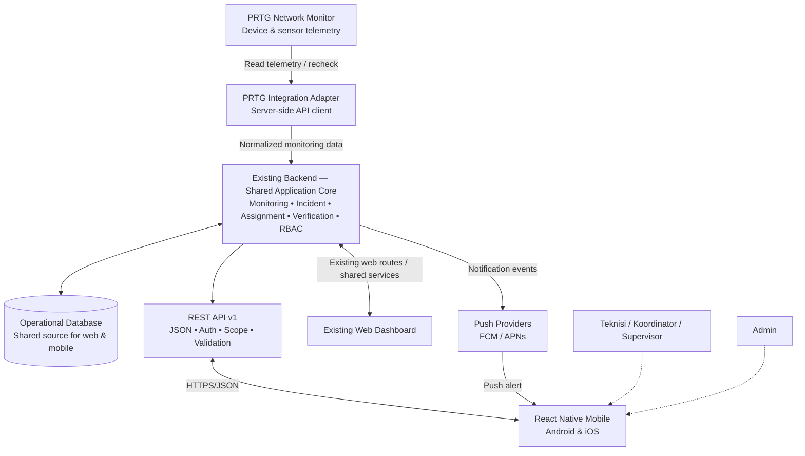
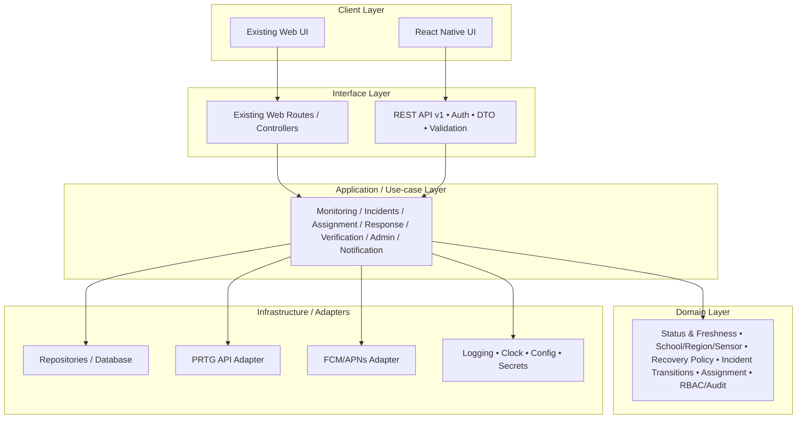
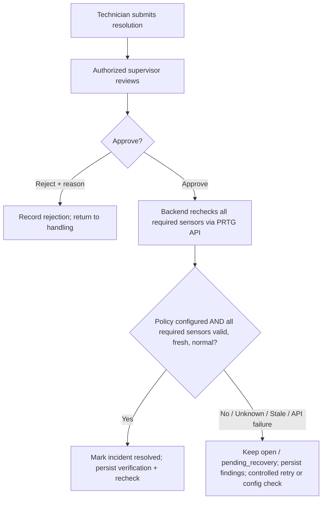
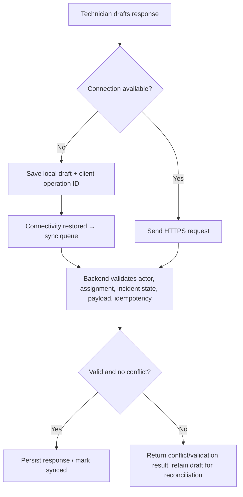
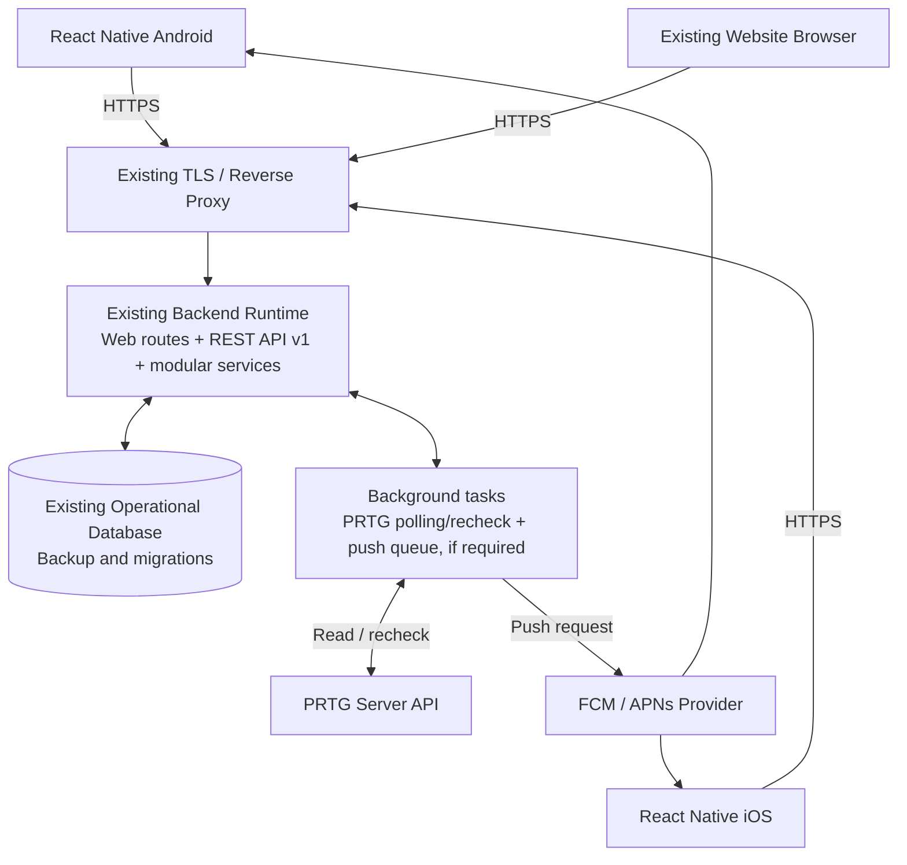

# PRTG School Platform — Konteks Arsitektur untuk AI Agent

> **Sumber:** *PRTG School Platform — System Architecture Document*, SAD-PRTG-001, v0.2, 10 November 2026, 22 halaman. Dokumen ini adalah **adaptasi terstruktur untuk AI Agent**, bukan salinan teks kata demi kata. Desain, aturan, struktur konseptual, contoh API/JSON, dan keputusan terbuka berasal dari PDF. Instruksi operasional khusus AI Agent ditambahkan pada bagian yang ditandai sebagai *panduan agent*.
>
> **Peringatan epistemik terpenting:** PDF menggambarkan **arsitektur target**, bukan bukti implementasi repository. Pada saat dokumen sumber dibuat, source code existing **belum diaudit file-per-file**. Jangan mengklaim framework, database, route, model, worker, deployment, atau integrasi tertentu sudah ada tanpa memeriksa source code/lingkungan aktual.

## 0. Cara Menggunakan Konteks Ini (Panduan AI Agent)

### 0.1 Prioritas acuan

1. **Fakta implementasi:** isi source code, konfigurasi, schema/migration, test, dokumentasi repository, dan hasil eksekusi yang benar-benar diperiksa.
2. **Ketentuan arsitektur target:** prinsip, role, lifecycle, integrasi, keamanan, dan MVP yang ditentukan dokumen ini.
3. **PRD v0.2:** disebut sebagai acuan pada PDF, tetapi **isinya belum diberikan di sini**. Jika tersedia di repository, baca dan cocokkan sebelum memutuskan detail kebutuhan produk.
4. **Usulan agent:** hanya boleh diperlakukan sebagai usulan sampai disetujui/terverifikasi; jangan mengubah ketentuan tertutup secara diam-diam.

Jika source code existing berbeda dengan struktur folder target, **jangan memindahkan seluruh file secara paksa**. Pertahankan pola framework existing, lalu pisahkan concern secara bertahap dengan regression test.

### 0.2 Makna status keputusan

| Label | Makna | Contoh |
|---|---|---|
| `DISEPAKATI` | Ketentuan/ADR yang sudah ditentukan oleh dokumen target | PRTG source of truth; lima role; recheck wajib |
| `TARGET` | Bentuk rancangan yang diinginkan, belum tentu sudah ada | `/api/v1`, struktur folder, entitas, skema logis |
| `TERBUKA` | Harus ditetapkan setelah audit, pengukuran, atau keputusan pemilik produk | Framework backend, polling, Expo vs bare |
| `ASUMSI` | Prasyarat dokumen yang perlu diverifikasi | Izin akses source, PRTG API, duty teknisi |
| `DI_LUAR_MVP` | Tidak masuk Focused MVP 1.0 | AI diagnosis, GPS tracking, chat |
| `PANDUAN_AGENT` | Derivasi operasional yang ditambahkan untuk membantu agent | Cara audit, perubahan kecil, daftar cek output |

### 0.3 Guardrail yang tidak boleh dilanggar

- **PRTG adalah satu-satunya source of truth telemetry**. Jangan menulis status `online` buatan ke sensor PRTG, atau menyimpulkan pulih hanya karena teknisi menandai tugas selesai.
- **Network status, incident status, dan sync status adalah domain berbeda.** Jangan mencampurkan atau menyamakan transisinya.
- Website dan mobile menggunakan **business logic operasional yang sama** melalui backend bersama; jangan menduplikasi perhitungan status di dua client.
- Akses PRTG hanya **server-side** melalui adapter. Jangan menaruh PRTG key, credential DB, atau secret push provider di mobile/browser.
- **Otorisasi penting selalu diperiksa di backend** berdasarkan role, permission, scope wilayah, status akun, dan hubungan dengan incident/assignment.
- **Admin tidak boleh menyetujui/menolak penyelesaian incident.** `incidents.verify` hanya untuk Supervisor Wilayah dan Supervisor Utama sesuai scope.
- **Satu rangkaian gangguan pada sekolah memiliki satu incident utama aktif**, dengan banyak sensor terkait. Incident yang sudah `resolved` tidak digabung dengan gangguan baru.
- Penyelesaian resmi membutuhkan **resolution submission → supervisor approval → PRTG recheck atas seluruh sensor wajib → baru `resolved` jika valid/normal**.
- Sensor `unknown`, `stale`, gagal baca, tidak memenuhi policy, atau policy belum dikonfigurasi **tidak boleh menghasilkan penutupan otomatis**.
- **Offline MVP hanya cache dan draft**; tindakan yang mengubah state resmi tetap online, harus melewati backend.
- Histori assignment, respons, review, dan audit tidak dihapus/ditimpa; koreksi dicatat sebagai entri baru.
- Lindungi website existing dengan **refactoring bertahap, regression test, migrasi kompatibel, dan rollback**.
- Jangan menganggap contoh route, direktori, entitas, atau payload dalam dokumen ini sudah ada sebelum audit.

### 0.4 Alur kerja agent ketika mendapat tugas coding (PANDUAN_AGENT)

1. **Inventarisasi** area kode yang relevan (routing, services, models, PRTG integration, auth, storage, tests), tanpa mengubah perilaku.
2. **Nyatakan status fakta**: `ditemukan di repository`, `disebut di dokumen target`, atau `belum diketahui`.
3. **Petakan dampak** ke otorisasi lima role, scope, status, audit, integrasi PRTG, web existing, dan offline sync.
4. **Rancang perubahan minimum** mengikuti framework existing, sambil mengejar arsitektur shared backend.
5. **Implementasikan dan uji** termasuk kasus negatif, duplikasi/idempotency, stale/unknown, dan regressions jika relevan.
6. **Laporkan** file yang diubah, migrasi, hasil tes, asumsi, keterbatasan, dan hal yang memerlukan keputusan manusia.
7. **Jangan membuat angka target** response time, polling, availability, atau kapasitas sebelum baseline pengukuran tersedia.

---

## 1. Ringkasan Produk, Tujuan, dan Lingkup

**Identitas dokumen:** `SAD-PRTG-001`; versi `0.2`; dibuat `2026-11-10`; status **draft untuk review/validasi teknis**; acuan produk **PRTG_PRD_v0.2 — Focused MVP 1.0**. [Sumber: PDF hlm. 1–3]

### 1.1 Tujuan arsitektur

- Mempertahankan website monitoring yang telah berjalan.
- Merefactor backend existing menjadi **backend bersama** yang menangani data monitoring dan alur incident.
- Menambahkan aplikasi **React Native + TypeScript** untuk Android dan iOS.
- Menjadikan backend pusat data operasional, RBAC, assignment, response, verification, audit, notifikasi, dan REST API.
- Menggunakan PRTG sebagai mesin pengamatan jaringan/sensor, bukan sebagai pengelola workflow teknisi.

### 1.2 Enam modul MVP 1.0

| Modul | Cakupan yang harus didukung |
|---|---|
| Authentication & User Access | Login, token/session, lima role tetap, scope wilayah, administrasi user dasar |
| Network Monitoring | Dashboard online/offline, daftar sekolah, filter wilayah, device/sensor, waktu pemeriksaan, indikator stale/unknown |
| Incident Management | Satu incident utama aktif per sekolah/rangkaian gangguan, banyak sensor terkait, lifecycle dan history |
| Assignment & Response | Auto-assignment sederhana, assignment/reassignment manual, acknowledgement, action note, foto sederhana jika perlu, resolution submission |
| Verification & Synchronization | Supervisor approve/reject, PRTG recheck sensor wajib, closure, konsistensi web/mobile |
| Notification & Offline Support | Push Android/iOS, routing wilayah/assignment, cache, draft offline, sync queue, validasi server |

### 1.3 Di luar MVP (`DI_LUAR_MVP`)

- Prediksi/diagnosis gangguan dengan AI.
- Peta interaktif dan pelacakan GPS teknisi.
- Analitik kinerja teknisi lanjutan.
- SLA dan eskalasi kompleks.
- Chat internal.
- Offline penuh untuk claim, assignment, approval, dan perubahan status server.
- Custom permission builder bebas.
- Ekspor laporan mobile kompleks (ekspor existing website tetap dipertahankan).

> Jangan menambahkan fitur di luar MVP sebagai bagian dari perubahan rutin tanpa permintaan eksplisit pemilik proyek.

---

## 2. Prinsip dan Driver Kualitas (`DISEPAKATI`)

| Prinsip/driver | Implikasi implementasi |
|---|---|
| PRTG source of truth | Monitoring hanya berdasarkan telemetry valid dari PRTG |
| Shared backend | Web dan mobile berbagi service dan database operasional |
| Pemisahan state | Network, incident, sync tidak boleh dicampur |
| API-first | REST/JSON berversi untuk mobile; website dimigrasi bertahap |
| Authorization server-side | Periksa role, permission, wilayah, assignment pada server |
| Refactoring inkremental | Pertahankan kontrak dan perilaku website existing |
| Offline terbatas | Cache/draft lokal; operasi status resmi online |
| Auditability | Transisi incident, assignment, response, review, role/config dan sync dapat ditelusuri |
| Reliability | `stale`/`unknown` bukan `online`; timeout dan retry terkontrol |
| Security | Token aman, secret server-side, HTTPS |
| Cross-platform | Codebase RN bersama, tetapi pengujian Android/iOS terpisah |
| Maintainability | Controller tipis; use case, domain, repository, adapter terpisah |

[Sumber: PDF hlm. 4]

---

## 3. Konteks Sistem dan Batas Tanggung Jawab

### 3.1 Diagram konteks (rekonstruksi semantik dari Gambar 1, hlm. 5)



### 3.2 Kepemilikan concern

| Komponen | Tanggung jawab | Bukan tanggung jawab |
|---|---|---|
| PRTG | Memantau sensor/device dan menyediakan telemetry melalui API | Assignment, catatan teknisi, approval |
| PRTG Adapter | Auth ke PRTG dari server; mapping sensor; timeout/retry; recheck | Memberi credential kepada mobile |
| Backend bersama | Normalisasi monitoring, workflow, RBAC, verification, notification orchestration, audit, API | Menggantikan mesin monitoring PRTG |
| Website existing | Dashboard dan tampilan data operasional dari backend | Implementasi business logic sendiri yang berbeda dari mobile |
| React Native mobile | UI sesuai role, aksi pengguna, cache dan draft | Menentukan kebenaran status jaringan atau self-approval |
| Push provider | Mengirim push notification | Menjadi sumber data incident atau bukti dibaca |

**Makna sinkronisasi:** hasil kerja teknisi ditampilkan secara konsisten pada website monitoring **custom** dan mobile via backend bersama; backend melakukan recheck terhadap PRTG, **bukan menulis status online palsu ke PRTG**. [Sumber: PDF hlm. 5]

---

## 4. Arsitektur Logis dan Komponen Backend

### 4.1 Lapisan logis (Gambar 2, hlm. 6)



### 4.2 Kontrak lapisan

- **Web Presentation:** controller/routes/view yang ada, mempertahankan kontrak existing selama transisi.
- **REST API v1:** request validation, auth/scope, serialization, response HTTP; **tidak menampung business logic inti**.
- **Application/Use Cases:** orkestrasi monitoring, incident, assignment, response, verification, user admin, notification.
- **Domain Modules:** aturan workflow, policy, eligibility, normalisasi status, RBAC; tidak bergantung framework UI.
- **Repositories:** query, transaksi, baca/tulis entitas operasional secara terpusat.
- **PRTG Adapter:** autentikasi server-side, PRTG ID/status mapping, timeout, retry, recheck.
- **Push Adapter:** FCM/APNs, pencatatan hasil provider; status push bukan sumber kebenaran.
- **Cross-cutting:** config, secrets, structured logging, errors, validation, clock, correlation ID.

### 4.3 Domain fungsional

| Domain | Entitas dan logic utama |
|---|---|
| Identity & Access | User, Role, Permission, UserRegion, login, token, server authorization |
| User & Region Administration | Akun, role tetap, account status, region, mapping user dan sekolah |
| School & Monitoring | School, device, sensor, PRTG mapping, normalized status, last checked/stale |
| Incident | Satu school incident, affected sensors, deduplication, transisi, history |
| Assignment | Eligibility berdasar region/duty/workload, auto/manual/reassign, histori |
| Response | Acknowledge, action log, notes, metadata attachment, resolution submission |
| Verification | Supervisor review, approve/reject, required sensor policy, PRTG recheck, resolved decision |
| Notification | Audience routing, dedup, FCM/APNs attempts, device token |
| Offline Synchronization | Client operation ID, idempotency, validasi, sync conflict |

### 4.4 Struktur target backend (`TARGET`, **bukan struktur existing terverifikasi**)

```text
backend/
├── src/
│   ├── api/v1/                    # routes, controllers, serializers REST
│   ├── web/                       # website existing: routes/controllers/views
│   ├── modules/
│   │   ├── auth/
│   │   ├── users/
│   │   ├── regions/
│   │   ├── schools/
│   │   ├── monitoring/
│   │   ├── incidents/
│   │   ├── assignments/
│   │   ├── responses/
│   │   ├── verification/
│   │   └── notifications/
│   ├── integrations/prtg/        # PRTG API adapter
│   ├── infrastructure/           # database/repositories/push provider
│   ├── common/                   # middleware/errors/validation/response
│   └── config/                   # environment configuration
└── tests/                        # unit/integration/API/authorization
```

**Aturan:** ini pola konseptual, bukan instruksi rename/move besar-besaran. Utamakan konvensi framework existing dan perubahan inkremental. [Sumber: PDF hlm. 6–7]

---

## 5. Arsitektur Data

### 5.1 Model konseptual (Gambar 3, hlm. 8)

> Bukan DDL atau ERD fisik existing. Nama properti dan relasi final perlu ditetapkan setelah audit schema.

| Entitas | Field atau tujuan menurut dokumen |
|---|---|
| `User` | `id`, `name`, `username/email`, `account_status`, role binding |
| `Role` / `Permission` | `role_code`, `permission_code`, `description`; lima role tetap |
| `Region` / `UserRegion` | `region_id`, `name`, `status`, mapping user–wilayah |
| `School` | `school_id`, `name`, `region_id`, mapping device PRTG |
| `PrtgDevice` / `PrtgSensor` | referensi PRTG, `school_id`, `sensor_type`, `normalized_status`, `last_checked_at` |
| `SchoolRecoveryPolicy` | `school_id`, himpunan sensor wajib, versi kebijakan |
| `Incident` / `IncidentSensor` | `incident_id`, `school_id`, `incident_status`, `detected_at`, sensor terkait |
| `IncidentAssignment` | teknisi, assigner, waktu, alasan, status assignment |
| `ResponseLog` | actor, tindakan, catatan, evidence metadata, client-generated ID |
| `VerificationRecord` / `PrtgCheck` | supervisor, keputusan, alasan, hasil recheck, timestamp |
| `IncidentHistory` / `AuditLog` | state/role/config changes, actor, timestamp, request ID |
| `DeviceToken` / `NotificationLog` | platform, token, recipient, event, provider status, idempotency key |
| `SyncOperation` | client operation ID, payload type, sync status, server result/conflict |

Relasi konseptual utama:

- `Region` menaungi `School`; `UserRegion` mengaitkan user ke scope wilayah.
- Satu `School` memiliki banyak device dan sensor PRTG.
- `School` dapat memiliki banyak incident sepanjang waktu, tetapi **hanya satu incident utama aktif untuk satu rangkaian gangguan**.
- Satu `Incident` berelasi dengan beberapa sensor terdampak melalui `IncidentSensor`.
- `Incident` berelasi dengan historis `IncidentAssignment`, `ResponseLog`, `VerificationRecord`/`PrtgCheck`, dan history/audit.
- `SchoolRecoveryPolicy` mendefinisikan sensor wajib per sekolah.

### 5.2 Aturan integritas (`DISEPAKATI`)

1. Jangan membuat banyak incident utama aktif untuk rangkaian gangguan yang sama pada sekolah yang sama.
2. Kejadian baru **setelah** incident diselesaikan membuat incident baru; jangan membuka/merge history lama tanpa keputusan eksplisit.
3. Simpan histori assignment saat terjadi reassignment; jangan menghapus assignment sebelumnya.
4. Jangan menimpa/menghapus response log dan verification record; koreksi ditambahkan sebagai record auditable.
5. Secret PRTG/push tidak ada di tabel yang dapat dibaca mobile.
6. Network, incident, dan sync status dipisah, termasuk di DTO dan UI.
7. Pertimbangkan transaksi/locking atau optimistic concurrency pada assignment agar tidak terjadi dua assignment tidak sengaja.

### 5.3 Tiga state yang terpisah

| State | Nilai contoh dalam dokumen | Otoritas perubahan |
|---|---|---|
| Network Status | `online`, `offline`, `warning`, `unknown` | PRTG telemetry yang dinormalisasi oleh backend; freshness diperiksa |
| Incident Status | `detected`, `unassigned`, `assigned`, `acknowledged`, `in_progress`, `resolution_submitted`, `pending_verification`, `rejected`, `pending_recovery`, `resolved` | Backend use case dan otorisasi sesuai workflow |
| Sync Status | `draft`, `pending_sync`, `synced`, `conflict`, `failed` | Antrean mobile lokal + respons validasi server |

**Catatan:** status di atas adalah **daftar contoh nilai**, bukan tabel transisi lengkap. Dokumen belum mendefinisikan semua edge state machine, sehingga agent **tidak boleh mengasumsikan transisi apa pun legal**. Tetapkan diagram transition guard setelah audit/konfirmasi business rules.

**Freshness:** `last_checked_at` selalu dipertahankan; jika lebih tua dari batas yang nanti disepakati, tandai stale. `stale` adalah indikator kesegaran data, bukan sinonim `online`. [Sumber: PDF hlm. 8–9]

---

## 6. Integrasi PRTG dan API

### 6.1 Integrasi PRTG (`DISEPAKATI` dan `TERBUKA`)

- Browser dan mobile **tidak memanggil PRTG API langsung**.
- Adapter server-side melakukan autentikasi, baca PRTG endpoint, mapping device/sensor ke sekolah, normalisasi, controlled timeout/retry, dan verification recheck.
- Raw PRTG status dipetakan ke `online/offline/warning/unknown`; **mapping final harus diuji dengan telemetry sebenarnya**.
- Setiap snapshot memuat `last_checked_at`; status freshness ditampilkan.
- PRTG timeout, unknown, dan data stale **tidak boleh ditafsirkan sebagai pulih**.
- Credential API disimpan di server environment/secret store.
- **Belum diputuskan:** metode polling/event dan interval; tentukan setelah audit PRTG API, jumlah sensor, dan limit/rate API.

### 6.2 API conventions (`TARGET`)

- API mobile berbasis **REST/JSON berversi**, contoh prefix `/api/v1`.
- Gunakan schema/contract terdokumentasi melalui **OpenAPI**, validation, filtering, pagination, kode HTTP sesuai hasil.
- Website boleh tetap memakai web routes existing selama masa migrasi, **tetapi panggil shared service yang sama**.
- Respons sukses seragam dengan `success`, `data`, dan `meta` (`request_id`, timestamp).
- Error seragam dengan `success=false`, `error.code`, `error.message`, `error.details` jika relevan, dan `meta.request_id`.
- Timestamp API **ISO 8601**; penyimpanan UTC **direkomendasikan**; UI menampilkan Asia/Jakarta.
- Jangan mengembalikan HTTP 200 untuk validation atau authorization failure.

### 6.3 Daftar endpoint konseptual (PDF hlm. 10)

> Semua endpoint **contoh kontrak target**, **bukan route existing yang sudah diverifikasi**. Penamaan/payload final mengikuti audit repository dan API contract review.

| Area | Method | Endpoint |
|---|---|---|
| Auth | POST | `/api/v1/auth/login` |
| Auth | POST | `/api/v1/auth/refresh` |
| Auth | GET | `/api/v1/me` |
| Dashboard | GET | `/api/v1/dashboard` |
| Schools | GET | `/api/v1/schools` |
| Schools | GET | `/api/v1/schools/{id}` |
| Monitoring | GET | `/api/v1/schools/{id}/sensors` |
| Monitoring | GET | `/api/v1/monitoring/summary` |
| Incident | GET | `/api/v1/incidents` |
| Incident | GET | `/api/v1/incidents/{id}` |
| Incident | GET | `/api/v1/incidents/{id}/history` |
| Response | POST | `/api/v1/incidents/{id}/acknowledge` |
| Response | POST | `/api/v1/incidents/{id}/responses` |
| Resolution | POST | `/api/v1/incidents/{id}/resolution-submissions` |
| Assignment | POST | `/api/v1/incidents/{id}/assign` |
| Assignment | PATCH | `/api/v1/assignments/{id}` |
| Verification | POST | `/api/v1/incidents/{id}/verification/approve` |
| Verification | POST | `/api/v1/incidents/{id}/verification/reject` |
| User Admin | GET/POST/PATCH | `/api/v1/users` |
| Region Admin | GET/POST/PATCH | `/api/v1/regions` |
| Role | GET | `/api/v1/roles` |
| Devices | POST | `/api/v1/devices/register` |
| Notifications | GET | `/api/v1/notifications` |
| Offline sync | POST | `/api/v1/sync/operations` |

### 6.4 Success JSON (Lampiran A.1, hlm. 20)

```json
{
  "success": true,
  "data": {
    "id": "inc-123",
    "school": { "id": "sch-10", "name": "SMA Negeri 1 Bantul" },
    "network_status": "offline",
    "incident_status": "in_progress",
    "last_checked_at": "2026-11-10T10:30:00Z"
  },
  "meta": {
    "request_id": "req-abc123",
    "timestamp": "2026-11-10T10:31:00Z"
  }
}
```

### 6.5 Error JSON (Lampiran A.2, hlm. 20)

```json
{
  "success": false,
  "error": {
    "code": "FORBIDDEN",
    "message": "Anda tidak memiliki akses ke resource ini.",
    "details": []
  },
  "meta": { "request_id": "req-abc124" }
}
```

### 6.6 HTTP status guidance (Lampiran A.3, hlm. 21)

| HTTP | Arti |
|---|---|
| 200 | Sukses, mengembalikan representasi resource |
| 201 | Resource dibuat |
| 204 | Sukses tanpa body |
| 400 | Format/sintaks request tidak valid |
| 401 | Belum autentikasi atau token invalid |
| 403 | Terautentikasi, tetapi tidak punya permission/scope |
| 404 | Resource tidak ditemukan / tidak dapat diakses sesuai kebijakan |
| 409 | Konflik state/version/claim/sync |
| 422 | Business rule validation gagal |
| 429 | Rate limit terlampaui |
| 500 | Internal error tidak terduga |

### 6.7 Migrasi website

- Pertahankan route dan halaman existing pada tahap awal.
- Ekstrak logic monitoring dari HTML rendering handler ke shared use case/service.
- Controller web dan API memanggil service yang sama.
- Pindahkan konsumsi website bertahap setelah API contract lolos uji.
- Regression test: dashboard angka online/offline, durasi, filter wilayah, pencarian, daftar sekolah, ekspor yang sudah ada.

---

## 7. Identitas, Lima Role, dan Keamanan

### 7.1 Role tetap (`DISEPAKATI`; PDF hlm. 11)

| Role | Hak utama | Larangan penting |
|---|---|---|
| **Admin** | User/role management, konfigurasi/wilayah sesuai izin, monitoring semua sekolah, audit administratif | **Tidak memiliki `incidents.verify`; tidak approve/reject incident** |
| **Supervisor Utama** | Monitoring global, assignment override, verification lintas wilayah | Tidak otomatis berhak mengelola akun/role |
| **Supervisor Wilayah** | Monitoring, incident review dan verification sesuai wilayah | Tidak melewati scope wilayah tanpa hak |
| **Koordinator Teknisi** | Assignment/reassignment, workload dan progres tim/wilayah | Tidak melakukan approval/verification penyelesaian |
| **Teknisi** | Incident sesuai assignment/scope, acknowledge, response notes, offline draft, resolution submission | Tidak mengelola role, assignment orang lain, approval |

### 7.2 Permission code target

| Permission code | Role/penggunaan |
|---|---|
| `users.manage`, `roles.assign` | Admin, administrasi akun dan salah satu role tetap |
| `regions.manage`, `system_config.manage` | Admin, wilayah dan konfigurasi MVP yang diizinkan |
| `monitoring.view_all` | Admin dan Supervisor Utama, global monitoring |
| `incidents.view_scope` | Akses incident sesuai role, region dan assignment |
| `assignments.create`, `assignments.update` | Koordinator Teknisi, Supervisor Wilayah, Supervisor Utama sesuai scope |
| `responses.create`, `resolution.submit` | Teknisi ditugaskan (aksi lain sesuai kebijakan) |
| `incidents.verify` | **Hanya** Supervisor Wilayah/Supervisor Utama sesuai cakupan |

### 7.3 Authorization enforcement

Untuk setiap request sensitif, backend mengecek secara eksplisit:

1. Akun **aktif** dan terautentikasi.
2. Role serta permission untuk aksi yang diminta.
3. Scope wilayah yang berwenang.
4. Hubungan actor dengan incident/assignment yang valid (jika relevan).
5. State incident saat ini dan aturan workflow.

**UI hiding ≠ authorization.** Tidak boleh bergantung pada hidden button atau filter sisi client sebagai satu-satunya penjaga akses.

### 7.4 Kontrol keamanan minimum

- HTTPS/TLS untuk komunikasi client-server.
- Access token berumur pendek; refresh token ditangani aman sesuai kemampuan existing backend.
- Mobile menyimpan token pada secure native storage, tidak dalam plain local storage.
- PRTG/database/push provider secret hanya di server.
- Input validation, risiko-based rate limit, brute-force login protection, output sanitization.
- Audit user, role, wilayah, config, assignment, verification, dan recheck.
- Pertimbangkan MFA bagi Admin dan Supervisor Utama (**belum diputuskan**).
- Attachment foto dibatasi tipe/ukuran, akses terotorisasi, tanpa URL publik yang tidak sah.

---

## 8. Workflow Runtime dan Aturan Bisnis

### 8.1 Detection → incident creation (PDF hlm. 12)

1. PRTG Adapter membaca perubahan sensor dari PRTG API melalui mekanisme yang telah divalidasi.
2. Backend normalisasi state dan mencatat `last_checked_at`/freshness.
3. Backend mapping sensor → device → sekolah.
4. Jika belum ada incident aktif untuk rangkaian gangguan itu, buat satu incident utama; tautkan sensor terdampak.
5. Jika sudah ada, perbarui hubungan incident–sensor tanpa duplikasi incident.
6. Sensor `stale` atau `unknown` ditampilkan sebagai tidak pasti, **tidak dianggap online**.

### 8.2 Assignment otomatis sederhana

Urutan eligibility yang dinyatakan dokumen:

1. Teknisi berada di **wilayah tugas sekolah**.
2. Akun aktif dan sedang bertugas berdasarkan data **duty/jadwal** yang tersedia.
3. Hitung jumlah **incident aktif** yang menjadi tanggung jawab kandidat.
4. Pilih kandidat eligible dengan **active workload paling sedikit**.
5. Jika jumlah workload sama, **tie-breaker belum dipilih** (opsi contoh: round-robin / assignment terakhir).
6. Jika tidak ada kandidat, tandai incident dalam antrean `unassigned`; beri informasi ke koordinator/supervisor terkait.

Manual assignment / reassignment dapat dilakukan oleh **Koordinator Teknisi, Supervisor Wilayah, Supervisor Utama** sesuai scope. Catat actor, waktu, teknisi sebelumnya, teknisi baru, alasan; pertahankan histori lama.

**Risiko implementasi:** race condition memerlukan mekanisme transaksi/locking atau optimistic concurrency.

### 8.3 Technician response → supervisor review

1. Teknisi yang ditugaskan melakukan **acknowledgement** secara online.
2. Teknisi melakukan pemeriksaan dan mencatat tindakan/bukti.
3. Teknisi mengirim **resolution submission** secara online.
4. Incident memasuki tahap `pending_verification`.
5. Supervisor berwenang meninjau catatan/bukti.
6. Jika **reject**, alasan wajib disimpan; incident kembali ke proses penanganan (state rinci perlu ditetapkan secara eksplisit).
7. Jika **approve**, backend melakukan **PRTG recheck**, bukan otomatis `resolved`.

### 8.4 Recovery policy sensor wajib

- Setiap sekolah memiliki daftar **sensor wajib** yang dikelola Admin.
- **MVP:** semua sensor wajib harus normal **menurut policy yang berlaku**.
- Simpan snapshot recheck, keputusan, actor, timestamp, serta versi recovery policy untuk audit.
- Durasi stabil dan jumlah pembacaan sebelum dianggap recovered **masih terbuka**.

| Hasil PRTG recheck | Keputusan backend |
|---|---|
| Semua sensor wajib valid dan normal | Incident boleh ditutup `resolved`; catat supervisor + recheck |
| Sensor wajib offline/warning dan tidak memenuhi policy | Incident tetap terbuka / `pending_recovery`; simpan hasil |
| Sensor `unknown` atau data stale | Jangan anggap pulih; tetap terbuka / `pending_recovery` |
| PRTG timeout/API gagal | Tidak boleh tutup; log gagal; retry terkontrol |
| Required sensor policy belum dikonfigurasi | Tidak boleh tutup otomatis; minta verifikasi Admin/pengelola |

### 8.5 Diagram approval dan recovery (rekonstruksi Gambar 5, hlm. 13)



**Aturan:** tidak ada cabang `approve → resolved` tanpa recheck yang berhasil. [Sumber: PDF hlm. 12–13]

### 8.6 Offline draft dan safe synchronization (PDF hlm. 14)

**Boleh offline:** melihat cache dan detail tersimpan, menulis draft tindakan, mempersiapkan lampiran lokal.

**Wajib online:** login pertama, claim/assignment/reassignment, acknowledgement yang mengubah state resmi, final resolution submission, supervisor approve/reject, PRTG recheck, incident closure, administrasi user/wilayah.

- Local draft memiliki **client-generated UUID/idempotency key**.
- Ketika koneksi pulih, sync queue memproses draft/operasi yang diizinkan.
- Backend validasi actor/account, assignment, status incident, payload, dan idempotency key.
- Jika sudah pernah diproses, server mencegah duplicate side effect.
- Jika incident berubah/ditutup atau terjadi konflik, kirim **conflict response**; pertahankan draft untuk rekonsiliasi, **jangan silent overwrite**.
- Bedakan `draft`, `pending_sync`, `synced`, `conflict`, `failed` pada penyimpanan dan UI.



### 8.7 Push notification

- Domain events: incident baru, assignment dibuat/diubah, hasil verifikasi; pengingat/escalation **hanya bila disepakati**.
- Audience routing berdasarkan wilayah, jadwal/duty, assignment aktif.
- Gunakan deduplication untuk event identik.
- Payload push minimal: ringkasan dan deep link/ID incident; detail terbaru dibaca ulang melalui API setelah app dibuka.
- Simpan penerima, provider, attempt, hasil provider pada notification log.
- Status terkirim di FCM/APNs **bukan bukti user membaca**.

---

## 9. Aplikasi Mobile (`TARGET`)

### 9.1 Teknologi dan keputusan

- **Disepakati:** React Native + TypeScript, Android dan iOS satu codebase.
- **Belum diputuskan:** Expo atau bare React Native; harus menguji push native, background behavior, attachment, dan offline storage.
- Mobile adalah client operasional; **bukan source of truth** dan **bukan PRTG API consumer langsung**.

### 9.2 Struktur target mobile (PDF hlm. 15)

```text
apps/mobile/
├── src/
│   ├── app/                  # bootstrap/providers/config
│   ├── navigation/           # role-aware navigation
│   ├── features/
│   │   ├── auth/
│   │   ├── dashboard/
│   │   ├── schools/
│   │   ├── monitoring/
│   │   ├── incidents/
│   │   ├── assignments/
│   │   ├── responses/
│   │   ├── verification/
│   │   ├── notifications/
│   │   ├── administration/
│   │   └── offline-sync/
│   ├── shared/
│   │   ├── components/
│   │   ├── hooks/
│   │   ├── api/              # client/interceptors
│   │   ├── storage/          # cache/database + secure storage
│   │   ├── theme/
│   │   ├── types/
│   │   └── validation/
│   └── native/               # jika perlu modul/config native
├── android/
└── ios/
```

Direktori `android/`, `ios/`, dan `native/` merepresentasikan area native target ketika relevan; **jangan menganggap selalu ada pada pilihan Expo tertentu sebelum keputusan toolchain**.

### 9.3 Navigasi sesuai role

| Role | Halaman/fitur utama |
|---|---|
| Admin | Monitoring global, User Management, Role Assignment, Region/Configuration, Audit Log, Profile; incident read-only |
| Supervisor Utama | Dashboard global, Incident semua wilayah, Review/Verification, Assignment overview, laporan/history ringkas |
| Supervisor Wilayah | Dashboard wilayah, Incident wilayah, Review/Verification, Assignment oversight, History |
| Koordinator Teknisi | Dashboard tim, Unassigned queue, Assignment/Reassignment, Workload ringkas, Team incident |
| Teknisi | Dashboard tugas, My Incidents, Detail, Acknowledge, Response Form, Resolution Submission, Offline Draft, History |

### 9.4 App lifecycle dan background behavior (PDF hlm. 16)

- **Foreground:** refresh sesuai layar, render loading/error/stale.
- **Background:** push menjadi sinyal perubahan; jangan bergantung pada JavaScript yang berjalan terus-menerus.
- **Terminated:** deep link dari notification baru membuka incident **setelah auth dan authorization ulang**.
- **Resume/online kembali:** refresh ringan, proses antrean sync secara aman.
- **Android dan iOS:** uji permission, notification channels, lifecycle, secure storage, background behavior di **perangkat fisik**.

---

## 10. Deployment dan Operasional (`TARGET`)

### 10.1 Initial runtime/deployment (Gambar 7, hlm. 16)



- Jalankan API v1 **di deployment backend existing yang sama pada tahap awal** bila memungkinkan.
- Background worker/proses dapat dipisah jika polling/queue/push membutuhkannya.
- Operasional menggunakan **satu database bersama** pada fase awal.
- Pemisahan service/scaling horizontal belum diputuskan; memerlukan baseline kapasitas dan beban.
- Diagram target ini **bukan deskripsi deployment existing yang telah diverifikasi**.

### 10.2 Environment

| Environment | Tujuan | Keamanan/kondisi |
|---|---|---|
| Development | Local development dan unit testing | Data sintetis/disamarkan, credential berbeda |
| Staging | Integrasi PRTG sandbox/akses uji, API, push, UAT | Mendekati production; akses dibatasi |
| Production | Website dan aplikasi operasional | Secret terlindungi, monitoring, backup, rollback, change approval |

### 10.3 Distribusi aplikasi

- Android: internal APK / internal testing track.
- iOS: internal build / TestFlight sesuai akun organisasi.
- Promosi melalui development → internal QA → UAT → production candidate.
- Base URL API dan environment config terpisah; secret tidak di-hardcode di mobile.

### 10.4 Backup, migration, rollback

- Backup sebelum schema database berubah.
- Uji migration script di staging, usahakan backward-compatible.
- Lakukan backend refactor dalam perubahan kecil dengan regression tests.
- Pertahankan web routes existing sepanjang transisi.
- Rollback harus mempertimbangkan backend version, migration state, config, serta kompatibilitas client mobile.

---

## 11. Kualitas, Pengujian, dan Observability

### 11.1 Kualitas nonfungsional

- **Security:** TLS, token aman, server-side role/region/assignment authorization, secret, audit.
- **Consistency:** satu backend operasional, network vs incident state terpisah.
- **Reliability:** timeout/retry terkontrol, `stale/unknown`, queue jika perlu, backup/restore.
- **Maintainability:** domain modular, controller tipis, adapter, API versioning, OpenAPI, automatic tests.
- **Performance:** pagination/filter server-side, indeks sesuai query, cache snapshot yang aman.
- **Usability:** form teknisi ringkas, teks/ikon status jelas, stale indicator, navigasi berdasarkan role.
- **Cross-platform:** uji RN Android/iOS layout, push, lifecycle, secure storage, offline.

**Tidak ada angka target yang telah disepakati** untuk API response time, interval polling, notification latency, uptime, dan kapasitas. Tentukan **setelah** inventarisasi sekolah/sensor, batas PRTG API, baseline server, volume event, dan load testing staging.

### 11.2 Observability

- Structured logs memuat `request_id` atau `correlation_id` untuk read PRTG, incident creation, assignment, push, sync, verification, recheck.
- Metrics: PRTG API success rate, umur telemetry, incident aktif, assignment latency, push failures, verification outcomes, sync conflicts, API errors.
- Alert untuk PRTG API unavailable, job failures, queue buildup, kenaikan API error.
- Scheduled backups dan **uji restore terdokumentasi**.
- Jangan mencetak secret, token utuh, atau konten sensitif yang tidak perlu pada log.

### 11.3 Matrix pengujian (PDF hlm. 18)

| Jenis tes | Yang wajib dicakup |
|---|---|
| Unit | Status mapping, state transition, assignment eligibility, required sensor recovery policy, permissions |
| Integration | PRTG adapter, repository/transaction, push adapter, verification orchestration |
| API contract | JSON schema, HTTP codes, input validation, pagination, auth, backward compatibility |
| Authorization | Lima role, negative tests, region scope, assigned technician, **Admin non-verifier** |
| Mobile | Role navigation, offline draft, sync retry/conflict, duplicate submission, deep link, secure storage |
| End-to-end/UAT | PRTG detection → assignment → response → submit → supervisor review → PRTG recheck → web/mobile update |
| Regression website | Dashboard online/offline, filter wilayah, durasi, pencarian, existing export |

### 11.4 Contoh kasus acceptance turunan (`PANDUAN_AGENT`, bukan daftar formal PRD)

- Ketika sensor PRTG tidak dapat dibaca, UI menampilkan `unknown`/stale; incident tidak dapat ditutup berdasarkan asumsi.
- Ketika satu sekolah memiliki beberapa sensor bermasalah dalam gangguan sama, hanya satu incident utama aktif dihasilkan.
- Ketika tidak ada teknisi eligible, incident berada dalam antrean `unassigned`.
- Ketika Admin mencoba approve verification, backend mengembalikan penolakan akses.
- Ketika supervisor approve tetapi sensor wajib masih offline, incident berada pada `pending_recovery`.
- Ketika supervisor approve tetapi policy sensor belum diatur, incident tidak langsung closed.
- Ketika draft offline dikirim ulang dengan idempotency key sama, tidak terjadi response log ganda.
- Ketika incident telah closed sebelum sinkronisasi draft, backend mengirim conflict; mobile tidak silent overwrite.
- Ketika assignment diubah, histori assignment sebelumnya dan alasan override tetap tersedia.
- Setelah refactor, output web monitoring tetap konsisten terhadap baseline.

---

## 12. Strategi Migrasi dan Implementasi (M0–M7)

| Tahap | Pekerjaan | Exit criteria |
|---|---|---|
| **M0** — Source & license baseline | Validasi izin penggunaan, simpan baseline, dokumentasi run, dependencies | Repository dapat dijalankan; lisensi/atribusi jelas |
| **M1** — Backend audit | Framework, routes, controllers, queries, PRTG API, auth, DB, hosting | As-is architecture, route inventory, data mapping, risk list |
| **M2** — Stabilization | Baseline tests, logging, config/secrets, exception handling, tanpa ubah web behavior | Regression baseline lulus; konfigurasi aman |
| **M3** — Shared business services | Pisahkan adapter PRTG, monitoring, incident, data access dari rendering | Web tetap jalan; logic dipakai web/API |
| **M4** — REST API v1 | JSON contract, auth middleware, validasi, filtering, OpenAPI | API contract tests lulus; web/mobile konsisten |
| **M5** — Operational workflow | RBAC, assignment, response, verification, recovery policy, notification | E2E workflow backend lulus di staging |
| **M6** — Mobile MVP | RN screens, API client, push, cache/draft, safe sync | Build internal Android/iOS bisa diuji |
| **M7** — UAT & release candidate | Test role, PRTG recheck, offline sync, regressions, demo | Acceptance criteria PRD dipenuhi; kandidat rilis disetujui |

### Refactoring aman (`DISEPAKATI`)

- Jangan menghapus endpoint atau web routes lama sebelum semua consumer teridentifikasi.
- Ekstrak shared service di belakang controller existing lebih dahulu.
- Implementasikan API v1 menggunakan service tersebut, bukan salinan logic monitoring.
- Regression-test dashboard dan routes lama sebelum memindahkan consumer website.
- Pertahankan fallback selama migrasi; gunakan migration kompatibel bila memungkinkan.
- Catat perubahan arsitektur/schema dalam ADR dan changelog.

[Sumber: PDF hlm. 18–19]

---

## 13. Risiko, Asumsi, dan Keputusan Terbuka

### 13.1 Risiko yang tercantum dalam PDF

| Risiko | Dampak | Mitigasi |
|---|---|---|
| Arsitektur backend berbeda dari asumsi | Folder/API target perlu adaptasi | Audit repository; pertahankan framework existing |
| PRTG API lambat/unavailable | Monitoring stale, verification tertunda | Timeout/retry, unknown/stale, jangan auto-close |
| School–sensor mapping salah | Incident/recovery salah | Validasi mapping, required sensor config per sekolah, audit |
| Notifikasi salah sasaran/duplikat | Gangguan operasi | Routing by scope/assignment, dedup, logs |
| Race condition assignment | Dua teknisi mendapat tugas sama | Transaction/locking/optimistic concurrency |
| Offline conflict | Draft menimpa state baru | Idempotency, version checking, conflict response |
| Website regression | Monitoring lama terganggu | Regression suite, gradual migration, rollback |
| Scope creep | MVP terlambat | Tunda AI, GPS, SLA lanjut, chat, analytics kompleks |

### 13.2 Asumsi untuk diverifikasi (`ASUMSI`)

- Izin penggunaan source dari pemilik repository tersedia; license/attribution dipenuhi.
- PRTG API server-side dapat diakses dengan izin baca untuk monitoring/recheck.
- Backend existing dapat diuji/direfactor tanpa menghentikan website operasional.
- Sekolah memiliki mapping region, device, sensor dan required sensor policy yang dapat divalidasi.
- Duty/schedule teknisi tersedia atau dapat ditambahkan melalui konfigurasi sederhana.
- Akses internal test Android dan TestFlight iOS tersedia dari organisasi.

### 13.3 Keputusan teknis yang **belum terkunci** (`TERBUKA`)

| Topik | Status/arah keputusan |
|---|---|
| Backend framework/database | **Belum diketahui**; pertahankan existing setelah audit |
| Expo vs bare React Native | Uji push, background, attachment, secure/offline storage |
| Database lokal mobile | SQLite atau setara; kaji enkripsi dan migrasi |
| PRTG polling/trigger & interval | Audit PRTG API, rate limit, jumlah sensor, baseline |
| Required sensor recovery stability | Semua wajib normal; perlu keputusan durasi stabil/jumlah pembacaan |
| Assignment tie-breaker | Min active workload disepakati; round-robin/waktu terakhir hanya opsi |
| Attachment storage | Object storage/local server sesuai infrastruktur dan kebijakan akses |
| Performance/availability targets | Ditentukan dari baseline/load testing staging |
| MFA Admin/Supervisor Utama | Dipertimbangkan; kebijakan organisasi menentukan |

**Klarifikasi yang belum disediakan oleh dokumen sumber:** kontrak payload final, authorization matrix rinci per endpoint, skema DB fisik/index/unique constraint, tepatnya kapan sebuah incident dianggap satu “rangkaian gangguan”, status transition graph lengkap, duty data source, PRTG sensor raw mapping final, provider push dan storage final. Jangan mengarangnya sebagai ketentuan yang sudah disahkan.

---

## 14. Architecture Decision Records (Lampiran B, PDF hlm. 21)

| ADR | Keputusan | Status |
|---|---|---|
| ADR-001 | PRTG tetap source of truth untuk telemetry | **Disepakati** |
| ADR-002 | Backend existing menjadi shared backend | **Disepakati** |
| ADR-003 | Mobile React Native + TypeScript | **Disepakati** |
| ADR-004 | REST API v1 + JSON standar | **Disepakati sebagai target** |
| ADR-005 | Lima role tetap + server-side RBAC dan region scope | **Disepakati** |
| ADR-006 | Closure memerlukan supervisor approval **dan** PRTG recheck | **Disepakati** |
| ADR-007 | Satu incident utama aktif per sekolah dengan beberapa sensor terkait | **Disepakati** |
| ADR-008 | Assignment dengan region, duty, minimal active workload | **Disepakati; tie-breaker terbuka** |
| ADR-009 | Offline untuk cache/draft saja; operasi kritis online | **Disepakati** |
| ADR-010 | Framework backend dan Expo/bare ditentukan setelah audit/uji | **Terbuka** |

---

## 15. Bukti Akademik / CPMK TIO5023 (PDF hlm. 20)

| CPMK | Bukti yang perlu disiapkan saat implementasi |
|---|---|
| `CPMK-TIO5023-1` | Diagram konteks/runtime, Android lifecycle, foreground/background, push permission, secure storage, rujukan kode |
| `CPMK-TIO5023-2` | Diagram logical architecture, struktur kode, API contract, PRTG adapter, separation of concerns |
| `CPMK-TIO5023-3` | PRD, role/user flows, wireframe, wawancara, usability testing, revisi |
| `CPMK-TIO5023-4` | APK/iOS build, source code, README/build guide, test cases/results, demo E2E |

**Dokumen arsitektur saja tidak membuktikan CPMK tercapai**; harus ada implementasi, build, pengujian, validasi, dan demonstrasi.

---

## 16. Glosarium (Lampiran C, PDF hlm. 22)

| Istilah | Arti dalam proyek |
|---|---|
| PRTG | Platform monitoring jaringan yang menyediakan status device/sensor |
| Telemetry | Data pengukuran dan status dari sistem monitoring |
| Incident | Catatan rangkaian gangguan sekolah beserta sensor terdampak |
| Network Status | Kondisi jaringan/sensor berdasarkan PRTG |
| Incident Status | Status penanganan melalui backend workflow |
| Recovery Policy | Sensor wajib dan syarat pemulihan per sekolah |
| PRTG Recheck | Pemeriksaan ulang sensor wajib melalui PRTG API sebelum closure |
| Idempotency | Pengiriman ulang satu operasi tidak menghasilkan duplikasi |
| Stale Data | Telemetry melampaui ambang waktu freshness |
| RBAC | Role-based permission yang dikombinasikan dengan scope |

---

## 17. Checklist Implementasi untuk Agent (`PANDUAN_AGENT`)

Gunakan sebagai checklist saat suatu perubahan menyentuh modul terkait; ini **bukan** bukti bahwa fitur sudah selesai.

- [ ] Source code relevan benar-benar diperiksa; `as-is` dan `target` dibedakan.
- [ ] API client tidak mengakses PRTG secara langsung; credential berada di server.
- [ ] `network_status`, `incident_status`, dan `sync_status` tetap terpisah.
- [ ] Role, permission, wilayah, akun, dan assignment diperiksa server-side.
- [ ] Admin/Koordinator/Teknisi tidak memperoleh `incidents.verify`.
- [ ] Reassignment dan response log tetap historis/auditable.
- [ ] Incident deduplication dan concurrency diperhitungkan.
- [ ] Approval supervisor **diikuti** PRTG recheck atas semua required sensors.
- [ ] Unknown/stale/timeout/required-policy-missing tidak menghasilkan `resolved`.
- [ ] Offline draft memakai stable operation ID, idempotency dan conflict behavior.
- [ ] Semua event penting mencatat request/correlation ID tanpa secret.
- [ ] Existing web routes tetap berfungsi dan hasil dashboard konsisten.
- [ ] API response, error status, authorization negative cases diuji.
- [ ] Android/iOS behavior diverifikasi pada perangkat nyata jika relevan.
- [ ] Perubahan DB memiliki migration/backup/rollback plan yang proporsional.
- [ ] Usulan melampaui MVP atau keputusan terbuka diangkat ke pemilik proyek.

### Template ringkas laporan kerja agent (`PANDUAN_AGENT`)

```markdown
## Hasil perubahan
- Permintaan:
- Bagian kode yang diaudit:
- Fakta as-is yang ditemukan:
- Aturan arsitektur yang dipakai:
- File/migration yang diubah:
- Perubahan kontrak/API/data (jika ada):
- Tes dijalankan dan hasil:
- Risiko/regression dan rollback:
- Keputusan terbuka / asumsi:
```

---

## 18. Rujukan Halaman Sumber (untuk validasi manusia)

| PDF halaman | Isi utama |
|---|---|
| 1–2 | Sampul, kontrol dokumen, riwayat revisi, daftar isi |
| 3 | Tujuan, enam modul MVP, out-of-scope, batas audit |
| 4 | Prinsip dan quality drivers |
| 5 | Gambar 1 konteks sistem, tanggung jawab, sinkronisasi |
| 6–7 | Gambar 2 layered architecture, modul, struktur target backend |
| 8–9 | Gambar 3 model konseptual data, integrity, status domains, PRTG adapter |
| 10 | API endpoint target, response format, website integration |
| 11 | Lima role, permission, security |
| 12–13 | Gambar 4–5 incident, assignment, supervisor verification, required sensor recheck |
| 14–15 | Gambar 6 offline sync, notifications, mobile architecture dan navigasi |
| 16–17 | Gambar 7 runtime/deployment, environment, quality dan observability |
| 18–19 | Testing, migration M0–M7, risiko, asumsi, keputusan terbuka |
| 20 | Lanjutan keputusan terbuka, CPMK TIO5023, JSON examples |
| 21 | HTTP guidance, ADR-001 s.d. ADR-010 |
| 22 | Glosarium |

**Catatan:** Untuk detail yang belum ditentukan, utamakan audit source code, PRD v0.2 (jika tersedia), hasil baseline sistem, dan persetujuan stakeholder. Jangan memperlakukan asumsi atau rekomendasi agent sebagai fakta implementasi.
